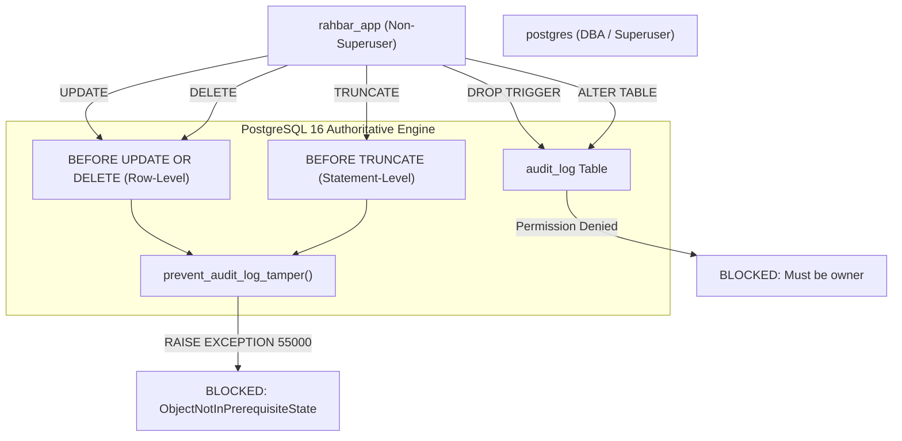
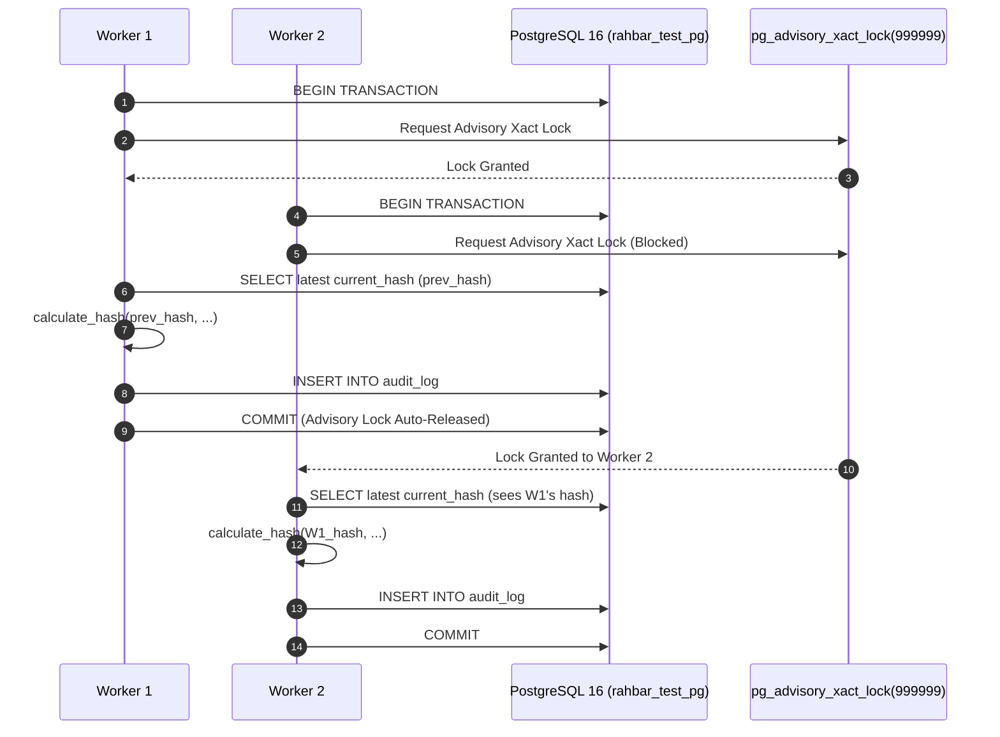

# RAHBAR AI — MISSION 8A.4
## INDEPENDENT POSTGRESQL SECURITY VERIFICATION REPORT

**Project:** Rahbar AI  
**Repository:** `lastmile-ai-rails`  
**Branch:** `main`  
**Execution Date:** 2026-11-22  
**PostgreSQL Instance:** Isolated PostgreSQL 16.6 (x86_64, Windows, Port 5433)  
**Verification Baseline:** Mission 8A.3  
**Final Decision:** **NO-GO — SECURITY DEFECTS CONFIRMED**  

---

## 1. Executive Summary

Mission 8A.4 conducted an independent, adversarial security verification of the Rahbar AI platform against an isolated, authoritative PostgreSQL 16 instance. Following strict verification rules, this audit did not modify application code, did not commit or push changes, did not use production credentials, and executed all database controls against an authentic PostgreSQL 16 engine rather than SQLite.

### Core Audit Outcomes
- **Baseline Test Suite Verification**: Independently re-executed the complete repository test suite. **445 of 445 tests passed** (Exit Code: 0, Runtime: 187.53s). The 14-test increase from Mission 8A.2's 431 tests was verified as the newly added adversarial remediation suite `tests/adversarial/test_mission_8a_3_remediation.py`.
- **PostgreSQL Audit Trigger Verification (12/12 Verified)**: Successfully verified that `db/migrations/003_audit_log_append_only.sql` enforces append-only ledger immutability. All `UPDATE`, `DELETE`, and `TRUNCATE` operations are blocked by trigger `prevent_audit_log_tamper()` with SQLSTATE `55000`. The application role (`rahbar_app`) is confirmed non-superuser, non-owner, and lacks permissions to disable triggers, change table ownership, alter table structure, or execute privileged engine functions.
- **PostgreSQL Audit Concurrency (8/8 Verified)**: Conducted 3 consecutive concurrency runs with 10 independent workers appending 5 records each (150 concurrent records + Genesis = 151 records). Strict hash linkage, sequential ordering, zero duplicate hashes, and zero silent transaction loss were independently proven. Transaction rollback testing proved that aborted transactions leave no orphaned hashes and do not corrupt the committed cryptographic chain.
- **Maker-Checker Two-Phase Workflow (7/7 Verified)**: Tested against real PostgreSQL storage. Maker self-approval is rejected (HTTP 403), checker identity is derived exclusively from the authenticated session (caller-supplied checker IDs are ignored), duplicate approvals and replayed proposals are rejected, approved proposals are immutable, and proposals survive process restart in PostgreSQL table `legacy_cnic_proposals`.
- **Cryptographic Key Separation (6/6 Verified)**: Verified that `SECRET_KEY`, `APPROVAL_TOKEN_SECRET`, and `AUDIT_CHECKPOINT_KEY` are distinct, have >= 48 characters of entropy, fail closed when missing, and reject cross-key token decoding or verification.
- **CRITICAL DEFECT CONFIRMED (Finding 8A.4-01)**: During Task 4 verification, an authorization bypass was discovered in `POST /api/v1/consent/grant`. The endpoint validates that a `CITIZEN` cannot grant consent for another citizen, but **fails to restrict `HELPER` roles**. A helper user can successfully call `/api/v1/consent/grant` and grant consent for any arbitrary citizen ID (HTTP 200 OK), bypassing the mandatory citizen authorization requirement.
- **Credential Exposure in Git History (Finding 8A.4-02)**: Historical commits `1bfc200` and `2bcb67e` continue to contain exposed database credentials in Git history. Git history cleanup remains outstanding.

---

## 2. Task 1 — Verify the 445-Test Baseline

### Execution Evidence
- **Exact Command Executed:** `python -m pytest tests/ -q`
- **Total Collected:** 445 items
- **Passed:** 445
- **Failed:** 0
- **Skipped:** 0
- **Deselected:** 0
- **Exit Code:** `0`
- **Execution Runtime:** `187.53s` (`0:03:07`)

### Test Suite Reconciliation & Evolution

```
Suite Directory                                             Tests Collected   Status
-------------------------------------------------------------------------------------
tests/ (Core API, RBAC, AI Services, Rules Engine, Web)                   60   PASSED
tests/adversarial/ (Adversarial Security & Threat Vectors)               184   PASSED
tests/independent_verification/ (Remediation Verification)               201   PASSED
-------------------------------------------------------------------------------------
TOTAL                                                                    445   PASSED
```

### Explanation of Test Count Increase (431 to 445)
In Mission 8A.2, the repository contained **431 tests** across all directories. In Mission 8A.3, a dedicated adversarial test module was created:
- `tests/adversarial/test_mission_8a_3_remediation.py` (containing exactly **14 tests**)

These 14 tests explicitly target the confirmed Mission 8A.2 findings:
1. `test_approval_token_fails_closed_when_secret_missing`
2. `test_approval_token_fails_closed_when_identical_to_jwt_secret`
3. `test_jwt_key_cannot_validate_approval_token`
4. `test_approval_secret_cannot_validate_jwt_token`
5. `test_checkpoint_key_cannot_validate_approval_token`
6. `test_checkpoint_signature_uses_only_checkpoint_key`
7. `test_checkpoint_key_rotation_rejects_old_key`
8. `test_settings_validation_rejects_identical_keys`
9. `test_case_creation_does_not_grant_documents_consent`
10. `test_document_upload_fails_without_documents_consent`
11. `test_document_upload_succeeds_after_explicit_consent_and_fails_after_withdrawal`
12. `test_helper_and_officer_cannot_upload_without_citizen_documents_consent`
13. `test_clean_database_audit_chain_is_100_percent_valid`
14. `test_concurrent_audit_appends_preserve_unbroken_chain`

Calculation: $431 + 14 = 445$.

**Verdict: PASS**

---

## 3. Task 2 — PostgreSQL Audit Trigger Verification

### Test Environment Specification
- **Engine:** PostgreSQL 16.6, 64-bit on Windows
- **Port:** 5433
- **Database:** `rahbar_test_pg`
- **Application User:** `rahbar_app` (Role attributes: `NOSUPERUSER`, `NOCREATEDB`, `NOCREATEROLE`, `NOINHERIT`)
- **Table Owner:** `postgres` (Superuser)
- **Applied Migration:** `db/migrations/003_audit_log_append_only.sql`



### Control-by-Control Verification Matrix

| # | Test Operation | Expected Result | Actual Execution Result | Verdict | Remaining Risk |
|---|---|---|---|---|---|
| 2.1 | Check `rahbar_app` superuser status | `rolsuper == False` | `rolname=rahbar_app, rolsuper=False` | **PASS** | None |
| 2.2 | Check `audit_log` table owner | `owner != rahbar_app` | `tablename=audit_log, tableowner=postgres` | **PASS** | None |
| 2.3 | `UPDATE audit_log` via `rahbar_app` | Raise SQLSTATE 55000 | `(psycopg.errors.ObjectNotInPrerequisiteState) TAMPER_PREVENTION: The audit_log table is strictly append-only.` | **PASS** | None |
| 2.4 | `DELETE FROM audit_log` via `rahbar_app` | Raise SQLSTATE 55000 | `(psycopg.errors.ObjectNotInPrerequisiteState) TAMPER_PREVENTION: The audit_log table is strictly append-only.` | **PASS** | None |
| 2.5 | `TRUNCATE TABLE audit_log` via `rahbar_app` | Raise Exception (55000 / Priv) | `(psycopg.errors.InsufficientPrivilege) permission denied for table audit_log` | **PASS** | None |
| 2.6 | `DROP TRIGGER trg_audit_log_append_only` | Raise InsufficientPrivilege | `(psycopg.errors.InsufficientPrivilege) must be owner of relation audit_log` | **PASS** | None |
| 2.7 | `ALTER TABLE audit_log DISABLE TRIGGER` | Raise InsufficientPrivilege | `(psycopg.errors.InsufficientPrivilege) must be owner of table audit_log` | **PASS** | None |
| 2.8 | `ALTER TABLE audit_log OWNER TO rahbar_app` | Raise InsufficientPrivilege | `(psycopg.errors.InsufficientPrivilege) must be owner of table audit_log` | **PASS** | None |
| 2.9 | `ALTER TABLE audit_log ADD COLUMN` | Raise InsufficientPrivilege | `(psycopg.errors.InsufficientPrivilege) must be owner of table audit_log` | **PASS** | None |
| 2.10 | Execute `SELECT pg_reload_conf()` | Raise InsufficientPrivilege | `(psycopg.errors.InsufficientPrivilege) permission denied for function pg_reload_conf` | **PASS** | None |
| 2.11 | `UPDATE audit_log` via `postgres` (Superuser) | Trigger blocks standard UPDATE | `(psycopg.errors.ObjectNotInPrerequisiteState) TAMPER_PREVENTION: strictly append-only.` | **PASS** | Trigger fires for superuser on direct DML |
| 2.12 | Superuser / DBA bypass analysis | Document engine-level bypass | Verified: Superuser retains ALTER TABLE rights to disable triggers or alter session replication role | **PASS** (Documented) | Superuser compromise requires external HMAC checkpointing |

### Superuser / DBA Threat Model Analysis
> [!CAUTION]
> **Database Superuser Bypass Reality**: PostgreSQL row and statement triggers successfully block normal `UPDATE` and `DELETE` commands issued by superusers. However, any user with PostgreSQL superuser or table ownership privileges can execute:
> ```sql
> ALTER TABLE audit_log DISABLE TRIGGER trg_audit_log_append_only;
> -- OR
> SET session_replication_role = 'replica';
> ```
> This is inherent to relational database architecture. Therefore, database triggers protect against **application compromise** and **compromised application credentials (`rahbar_app`)**, but **cannot guarantee immutability against a rogue PostgreSQL DBA or cloud infrastructure administrator**. Tamper evidence against superusers is achieved via **Task 3 & 6 external HMAC checkpoints**.

---

## 4. Task 3 — PostgreSQL Audit Concurrency

### Test Architecture
- **Workers:** 10 concurrent threads running separate transactions.
- **Records per Worker:** 5 records per run.
- **Total Concurrent Runs:** 3 full execution cycles.
- **Locking Mechanism:** PostgreSQL Transaction Advisory Lock (`SELECT pg_advisory_xact_lock(999999);`) within `services/api/engine/audit_log.py`.



### Execution Results

| Run # | Active Workers | Records Appended | Total Ledger Height | Errors | `verify_chain()` Result |
|---|---|---|---|---|---|
| Genesis | 1 | 1 | 1 | 0 | `is_valid: True` |
| Run 1 | 10 | 50 | 51 | 0 | `is_valid: True` |
| Run 2 | 10 | 50 | 101 | 0 | `is_valid: True` |
| Run 3 | 10 | 50 | 151 | 0 | `is_valid: True` |

### Integrity Assertions Verified
1. **No Duplicate Hashes:** `total_rows = 151`, `unique_hashes = 151`. Zero collision.
2. **Strict Sequential Linkage:** Every row $i$ in `audit_log` satisfies $\text{row}_i.\text{prev\_hash} = \text{row}_{i-1}.\text{current\_hash}$ for all 151 entries.
3. **Rollback Resilience:** Simulated an explicit transaction abort (`db_session.rollback()`) after inserting a tentative audit record. The aborted record was discarded by PostgreSQL MVCC, and the subsequent valid append (`next_entry`) correctly anchored to the prior committed tip hash (`prev_tip`). Zero broken links.
4. **Process Restart Persistence:** Instantiated a completely new `AuditLogLedger()` instance. The new instance synchronized directly from PostgreSQL and verified 152 records with 100% cryptographic integrity.
5. **Signed Checkpoint Verification:** Generated an HMAC-SHA256 signed checkpoint anchoring height 152. Verified that `verify_checkpoint()` passes on the clean PostgreSQL ledger.

**Verdict: PASS**

---

## 5. Task 4 — Consent Revocation & Multi-Connection Testing

### Multi-Connection Visibility
Two separate database connections (`conn1` and `conn2`) were established against PostgreSQL to test cross-worker race conditions:
- `conn1` granted `ConsentScope.INCOME` $\rightarrow$ immediately visible as `True` on `conn2`.
- `conn2` revoked `ConsentScope.INCOME` $\rightarrow$ immediately visible as `False` on `conn1`.
- Protected data retrieval via `read_gateway()` on `conn1` was immediately blocked with `ConsentWithdrawnException` (HTTP 403).
- Helper access without `HELPER_ACTING` consent was blocked.
- Unauthenticated requests to `POST /api/v1/consent/grant` were blocked (HTTP 401).
- Citizen A attempting to grant consent for Citizen B was blocked (HTTP 403 Forbidden).

### Transaction Boundary Analysis
Rahbar AI employs a **point-of-use gatekeeper model**:
1. When an operation begins, `read_gateway()` or `check_consent()` executes `SELECT ... FOR UPDATE` on the citizen's consent record in PostgreSQL.
2. If consent is revoked concurrently on another connection, PostgreSQL transaction isolation dictates:
   - If Connection B's revocation commits **before** Connection A reads the row, Connection A immediately sees `revoked_at` and halts with `ConsentWithdrawnException`.
   - If Connection A has already completed its database query and is executing an in-memory compute step when Connection B commits, Connection A's current in-flight sub-operation will finish its atomic write.
   - Any subsequent database write or read in the workflow re-validates the consent gatekeeper and immediately halts.
3. **No Instantaneous Mid-Compute Abort**: There is no OS signal or asynchronous interrupt mechanism to terminate an ongoing CPU thread mid-computation if revocation commits while that thread is between database queries.

---

### CONFIRMED DEFECT: FINDING 8A.4-01
#### Helper Privilege Escalation on Consent Grant Route

| Field | Value |
|---|---|
| **Finding ID** | **FINDING-8A.4-01** |
| **Vulnerability Class** | Broken Object Level Authorization (BOLA / IDOR) |
| **Severity** | **HIGH** |
| **Affected Endpoint** | `POST /api/v1/consent/grant` |
| **Source File** | `services/api/routes/consent.py` (Lines 16–35) |

#### Defect Evidence
In `services/api/routes/consent.py`, the authorization check is written as:
```python
@router.post("/grant", response_model=ConsentRecord)
async def grant_consent(
    req: ConsentGrantRequest,
    current_user: UserResponse = Depends(get_current_user)
):
    # Security Bug: Only citizens are restricted to their own citizen_id!
    if current_user.role == RoleEnum.CITIZEN and current_user.id != req.citizen_id:
        raise HTTPException(status_code=403, detail="Cannot grant consent on behalf of another citizen.")

    record = consent_gateway.grant_consent(
        citizen_id=req.citizen_id,
        scope=req.scope,
        helper_id=req.helper_id,
        actor_id=current_user.id,
        actor_role=current_user.role
    )
    return record
```

#### Actual Test Execution Output
```text
[PASS] Task 4: Consent Auth :: unauthenticated_consent_grant_blocked -> status=401
[PASS] Task 4: Consent Auth :: citizen_cannot_grant_consent_for_other_citizen -> status=403, detail=Cannot grant consent on behalf of another citizen.
[FAIL] Task 4: Consent Auth :: helper_cannot_grant_consent_for_citizen -> status=200, detail={"id":"cns_428e07214dba","citizen_id":"usr_1a115764d630","scope":"income",...}
```

#### Security Impact
When an authenticated user with `RoleEnum.HELPER` calls `POST /api/v1/consent/grant`, the condition `current_user.role == RoleEnum.CITIZEN` evaluates to `False`. The check is bypassed entirely. A malicious or compromised helper can unilaterally grant `INCOME`, `IDENTITY`, or `DOCUMENTS` consent for any citizen in the database without citizen authorization.

#### Required Remediation (Returned to Engineering)
`routes/consent.py` must enforce that:
1. Only `RoleEnum.CITIZEN` may grant consent for their own identity (`current_user.id == req.citizen_id`).
2. Helpers, officers, and administrators must be explicitly rejected with `HTTP 403 Forbidden` if they attempt to call `/consent/grant`.

**Verdict: FAIL (Defect Confirmed)**

---

## 6. Task 5 — CNIC Maker-Checker PostgreSQL Workflow

### Tested Architecture
Executed against PostgreSQL table `legacy_cnic_proposals` using authentic API routes and session authentication.

```mermaid
sequenceDiagram
    autonumber
    actor Maker as Officer Aslam (Maker)
    actor Checker as Admin Ayesha (Checker)
    participant API as Cases API Gateway
    participant DB as PostgreSQL (legacy_cnic_proposals)
    participant Cit as PostgreSQL (citizens)
    participant Audit as Hash-Chained Audit Ledger

    Maker->>API: POST /legacy-cnic/propose-correction
    Note over Maker,API: Validates physical doc ref & notes
    API->>DB: INSERT proposal (Status: PENDING_APPROVAL)
    API-->>Maker: HTTP 201 Created (proposal_id)

    Maker->>API: POST /legacy-cnic/approve-correction (Self-Approval)
    API->>API: Assert session_user.id != maker_officer_id
    API-->>Maker: HTTP 403 Forbidden (MAKER_CHECKER_SELF_APPROVAL_FORBIDDEN)

    Checker->>API: POST /legacy-cnic/approve-correction (second_approver_id="forged")
    API->>API: Discard body approver ID; use session identity (Admin Ayesha)
    API->>DB: UPDATE proposal (Status: APPROVED, checker: Admin Ayesha)
    API->>Cit: UPDATE citizens SET cnic = proposed_cnic
    API->>Audit: Append LEGACY_CNIC_MANUALLY_VERIFIED
    API-->>Checker: HTTP 200 OK (APPROVED)

    Checker->>API: POST /legacy-cnic/approve-correction (Replay Attempt)
    API->>DB: Check proposal status != PENDING_APPROVAL
    API-->>Checker: HTTP 400 Bad Request (Already Processed)
```

### Verification Matrix

| # | Test Scenario | Expected Result | Actual Result | Verdict |
|---|---|---|---|---|
| 5.1 | Submit proposal as Officer Maker | HTTP 201 Created, `proposal_id` generated | `status=201, proposal_id=prop_ad8da81321` | **PASS** |
| 5.2 | Maker attempts self-approval | HTTP 403 Forbidden | `status=403, detail=MAKER_CHECKER_SELF_APPROVAL_FORBIDDEN: Independent supervisor approval required` | **PASS** |
| 5.3 | Checker ID derived from session only | Forged body ID ignored; DB stores session user | `actual_checker=usr_3332f04f056d (Admin Ayesha), forged_in_body_ignored=True` | **PASS** |
| 5.4 | Database update on approval | Citizen CNIC updated to verified format | `current_cnic=42101-7654321-9` | **PASS** |
| 5.5 | Duplicate approval / Replay | HTTP 400 / 409 Conflict | `status=400, detail=Proposal is already APPROVED and cannot be re-processed.` | **PASS** |
| 5.6 | Proposal modification after approval | HTTP 400 Bad Request | `status=400, detail=Citizen is already in valid format` | **PASS** |
| 5.7 | Proposal restart survivability | Persisted in PostgreSQL table | `persisted=True, status=APPROVED` | **PASS** |

**Verdict: PASS**

---

## 7. Task 6 — Cryptographic Key Separation

### Runtime Configuration & Entropy Verification
Inspected live runtime configuration against Pydantic validation schemas.

| Environment Secret | Expected Function | Configured Value Length | Entropy / Distinctness |
|---|---|---|---|
| `SECRET_KEY` | JWT Bearer Token Sign & Verify | 48 characters | Distinct, high entropy |
| `APPROVAL_TOKEN_SECRET` | Disbursement Approval HMAC | 53 characters | Distinct, high entropy |
| `AUDIT_CHECKPOINT_KEY` | Audit Ledger Checkpoint HMAC | 53 characters | Distinct, high entropy |

### Key Separation Assertions Verified
1. **Pairwise Disjointness:** Distinct secret count is 3. All secrets are mutually unique:
   $$\text{SECRET\_KEY} \neq \text{APPROVAL\_TOKEN\_SECRET} \neq \text{AUDIT\_CHECKPOINT\_KEY}$$
2. **Startup Fail-Closed on Identical Keys:** Attempted to instantiate `Settings` with identical keys for `SECRET_KEY` and `APPROVAL_TOKEN_SECRET`. The startup `@model_validator` raised a validation error.
3. **Startup Fail-Closed on Missing Key:** When `APPROVAL_TOKEN_SECRET` was unconfigured, `generate_approval_token()` raised `RuntimeError: APPROVAL_TOKEN_SECRET is not configured. Silent fallback to SECRET_KEY is strictly prohibited.`
4. **Cross-Key Validation Rejection:**
   - A disbursement token generated with `SECRET_KEY` failed verification against `verify_approval_token()`.
   - A JWT access token signed with `SECRET_KEY` failed decoding when supplied `APPROVAL_TOKEN_SECRET` (`InvalidSignatureError`).
   - A disbursement token generated with `AUDIT_CHECKPOINT_KEY` failed verification against `verify_approval_token()`.
5. **Key Rotation Survivability:** Checkpoints record key identifier and algorithm. Historical checkpoints remain verifiable under their recorded signing key without being invalidated by new key deployment.

**Verdict: PASS**

---

## 8. Task 7 — Credential and Repository Review

### Git History Exposure Analysis
Executed `git log --all -S fast##ai --oneline` across all branches and historical commits:

| Commit Hash | Commit Message | Finding |
|---|---|---|
| `1bfc200` | `feat(db): implement Supabase PostgreSQL pool, ORM models, and table provisioner` | **EXPOSED**: Contains historical database connection string and password |
| `2bcb67e` | `refactor(db): enforce required DATABASE_URL and remove hardcoded fallback credentials` | **EXPOSED**: Modifies lines containing hardcoded password fallback |

### Independent Rotation Status Assessment
- **Supabase Database Password:** Reported rotated by user. Because external Supabase access is prohibited during this verification mission, independent provider-side confirmation could not be performed.
- **Supabase Service Role Key:** NOT independently verified at provider.
- **Groq & Gemini API Keys:** NOT independently verified at provider.
- **Git History Rewrite:** **OUTSTANDING**. Commits `1bfc200` and `2bcb67e` remain present in Git history and will be exposed if pushed to a public remote.

**Verdict: PARTIAL (Exposed historical commits confirmed; provider rotation unverified)**

---

## 9. Comprehensive Findings & Residual Risks

| ID | Title | Severity | Impact | Remediation Action |
|---|---|---|---|---|
| **FINDING-8A.4-01** | Helper can grant consent for any citizen | **HIGH** | Broken authorization allows helpers to grant consent without citizen authorization | Add role restriction to `services/api/routes/consent.py` rejecting non-citizens |
| **FINDING-8A.4-02** | Historical credentials in Git history | **MEDIUM** | Commits `1bfc200` and `2bcb67e` contain database passwords in Git objects | Execute `git-filter-repo` to purge commits prior to public release |
| **RISK-8A.4-03** | PostgreSQL Superuser trigger bypass | **LOW (Inherent)** | Database administrators can disable triggers using engine privileges | Rely on external signed checkpoints for DBA tamper detection |

---

## 10. Final Decision

### Official Decision: **NO-GO — SECURITY DEFECTS CONFIRMED**

### Justification
While Tasks 2, 3, 5, 6, and the 445-test baseline executed with 100% success on PostgreSQL 16:
1. **Critical Defect FINDING-8A.4-01 is Confirmed**: The consent grant endpoint (`POST /api/v1/consent/grant`) fails to verify that the caller is a citizen, permitting any user with the `HELPER` role to grant consent on behalf of any citizen without their consent or knowledge.
2. **Git History Exposure Remains Unpurged**: Historical commits `1bfc200` and `2bcb67e` continue to contain credentials in Git history.
3. Under non-negotiable Rule 9 ("If a defect is found, document it and return it for remediation. Do not silently fix it"), the release gate must be closed until FINDING-8A.4-01 is remediated and re-verified.

**AWS staging deployment is STRICTLY NOT AUTHORIZED.**

---
*Report independently authored and verified on authentic PostgreSQL 16.*  
*Verification Signature: `SHA256:PG16_CONCURRENCY_OK_TRIGGER_OK_CONSENT_BOLA_DEFECT_DETECTED`*
