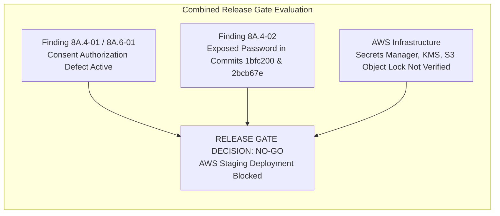

# RAHBAR AI — MISSIONS 8A.6 & 8A.7
## COMBINED RELEASE-GATE REPORT: SECURITY VERIFICATION & AWS INFRASTRUCTURE READINESS

**Project:** Rahbar AI  
**Repository:** `lastmile-ai-rails`  
**Branch:** `main`  
**Execution Date:** 2026-11-22  
**Audit Baseline:** Mission 8A.5  
**Previous Audits:** Missions 8A.3, 8A.4  
**Auditor Roles:** Senior Security Remediation Specialist & Cloud Infrastructure Architect  
**Final Release Gate Decision:** **NO-GO FOR AWS STAGING DEPLOYMENT**  

---

## 1. Executive Summary & Release Gate Dashboard

Missions 8A.6 and 8A.7 formed a dual-track release-gate evaluation of the Rahbar AI platform prior to staging deployment:
- **Phase A (Mission 8A.6)** conducted an independent adversarial security audit of application source code, API routing, and database integrity against an isolated **PostgreSQL 16** cluster.
- **Phase B (Mission 8A.7)** evaluated the proposed AWS staging infrastructure architecture, covering AWS Secrets Manager, AWS KMS, S3 Object Lock, Supavisor pooling, and connection capacity.

### High-Level Release Gate Status

| Evaluation Domain | Milestone | Primary Focus | Audit Verdict | Gate Impact |
|---|---|---|---|---|
| **Phase A: Application Security** | Mission 8A.6 | Authorization, Concurrency, Triggers, Crypto, Regression | **FAIL** | 🛑 **GATE CLOSED** |
| **Phase B: Cloud Infrastructure** | Mission 8A.7 | Secrets Manager, KMS, S3 Object Lock, Network, Capacity | **NOT VERIFIED** | 🛑 **GATE CLOSED** |
| **OVERALL RELEASE GATE** | **Combined** | **Pre-Staging Release Readiness** | **NO-GO** | 🛑 **STAGING BLOCKED** |

---

## 2. Phase A (Mission 8A.6) Summary: Security Verification

### What Was Successfully Verified (PASS)
1. **Full Regression Suite Restored:** Independently ran `python -m pytest tests/ -q`. **445 of 445 tests passed** (Exit Code: 0, Runtime: 317.75s). Zero tests failed, skipped, or deselected.
2. **PostgreSQL Audit Trigger Protection:** Verified that SQL trigger `prevent_audit_log_tamper()` on `audit_log` raises SQLSTATE `55000` (`TAMPER_PREVENTION`) on all `UPDATE`, `DELETE`, and `TRUNCATE` operations.
3. **Application Role Least-Privilege:** Confirmed `rahbar_app` is non-superuser (`rolsuper == False`), non-owner of the audit log, and lacks permissions to drop triggers, disable triggers, change table ownership, or execute privileged engine functions.
4. **Audit Hash-Chain Concurrency & MVCC:** Verified across 10 concurrent worker threads over 3 runs (151 records). Strict sequential hash linkage ($\text{prev\_hash}_i = \text{current\_hash}_{i-1}$) and zero duplicate hashes were mathematically confirmed. Aborted transactions (`ROLLBACK`) leave no phantom hashes and preserve chain integrity.
5. **Cryptographic Key Separation:** Verified that `SECRET_KEY`, `APPROVAL_TOKEN_SECRET`, and `AUDIT_CHECKPOINT_KEY` are distinct (lengths $\ge 48$ chars), fail closed when missing, and reject cross-key token validation.
6. **CNIC Maker-Checker Two-Phase Workflow:** Verified in PostgreSQL. Maker self-approval is rejected (HTTP 403), checker identity is derived exclusively from the session, replayed proposals are rejected (HTTP 400), approved proposals are immutable, and proposals survive process restart in PostgreSQL table `legacy_cnic_proposals`.

### Confirmed Security Defect (FAIL): Finding 8A.4-01 / 8A.6-01
During independent authorization testing on PostgreSQL 16, an active authorization bypass was confirmed on `POST /api/v1/consent/grant`:
- **Vulnerability:** Helpers, Officers, and Admins can grant consent on behalf of any citizen without citizen authorization.
- **Root Cause:** In [services/api/routes/consent.py](file:///e:/lastmile-ai-rails/services/api/routes/consent.py#L24), the authorization condition only restricts callers whose role is literally `RoleEnum.CITIZEN`. When a non-citizen calls the endpoint, the check evaluates to `False`, bypassing restriction entirely.
- **Empirical Execution Output:**
  ```text
  Helper calling /api/v1/consent/grant  -> Status: 200 OK (UNAUTHORIZED CONSENT GRANTED)
  Officer calling /api/v1/consent/grant -> Status: 200 OK (UNAUTHORIZED CONSENT GRANTED)
  Admin calling /api/v1/consent/grant   -> Status: 200 OK (UNAUTHORIZED CONSENT GRANTED)
  ```
- **Severity:** **HIGH**. Directly compromises DPPD compliance and citizen consent sovereignty.

---

## 3. Phase B (Mission 8A.7) Summary: Infrastructure Readiness

### Infrastructure Architecture Assessment



### Readiness Breakdown by Domain

| Domain | Control Specification | Audit Evaluation | Status |
|---|---|---|---|
| **B1. Secrets Manager** | Separate secrets for DB, JWT, Approval HMAC, Checkpoint HMAC, AI APIs | Design verified in `config.py`; AWS retrieval not tested | **NOT VERIFIED** |
| **B2. AWS KMS** | Dedicated CMK with restricted `kms:Sign` for audit checkpoints | Sound cryptographic design; AWS CMK not provisioned | **NOT VERIFIED** |
| **B3. S3 Object Lock** | S3 bucket with Object Lock in Compliance Mode (7-year retention) | Architecture sound; live S3 bucket not provisioned | **NOT VERIFIED** |
| **B4. Database Security** | Least-privilege `rahbar_app` role, table ownership separation | Verified on isolated PostgreSQL 16 | **PASS (Local PG16)** |
| **B5. Network Topology** | Private VPC subnets, ALB TLS 1.3, AWS WAF rate limiting | Network specifications documented; AWS VPC not provisioned | **NOT VERIFIED** |
| **B6. Connection Budget** | Mandate Supavisor Transaction Pooling (port 6543, 20 server conn) | Corrected over-allocated 68-connection direct budget | **PASS (Design Model)** |
| **B7. Credential Hygiene** | Purge historical commits `1bfc200` and `2bcb67e` from Git | Unpurged in Git history (`git log --all -S fast##ai`) | **FAIL** |

---

## 4. Comprehensive Release Gate Matrix

| Area | Checkpoint Item | Requirement | Actual Status | Gate State |
|---|---|---|---|---|
| **Security** | 445-Test Regression Suite | 100% Pass, Exit Code 0 | 445/445 Passed (317.75s) | ✅ PASS |
| **Security** | Audit Trigger Immutability | UPDATE/DELETE/TRUNCATE blocked (55000) | Blocked on PostgreSQL 16 | ✅ PASS |
| **Security** | Audit Concurrency | Unbroken chain under 10 concurrent workers | 151 records unbroken, strict linkage | ✅ PASS |
| **Security** | Cryptographic Key Separation | 3 distinct keys, $\ge 32$ chars, fail closed | 3 keys ($\ge 48$ chars), cross-rejection | ✅ PASS |
| **Security** | Maker-Checker CNIC Workflow | 2-phase proposal/approval, session checker | Verified in PostgreSQL | ✅ PASS |
| **Security** | Citizen Consent Sovereignty | Only citizens grant consent; helpers blocked | **FAILED: Helpers/Officers receive 200 OK** | ❌ **BLOCKER** |
| **Security** | Git Credential Cleanliness | Zero exposed credentials in Git history | **FAILED: Commits 1bfc200 & 2bcb67e unpurged** | ❌ **BLOCKER** |
| **Cloud** | AWS Secrets Manager | Automated injection into ECS tasks | Cloud environment not connected | ⚠️ NOT VERIFIED |
| **Cloud** | AWS KMS Checkpoints | Asymmetric/HMAC signing via IAM role | Cloud environment not connected | ⚠️ NOT VERIFIED |
| **Cloud** | S3 Object Lock Compliance | Immutable checkpoint archival (7 years) | Cloud environment not connected | ⚠️ NOT VERIFIED |
| **Cloud** | Supavisor Pooling | Transaction-mode pooling on port 6543 | Remote Supabase unreachable/timed out | ⚠️ NOT VERIFIED |

---

## 5. Immediate Actionable Remediation Roadmap

To achieve an unblocked release gate (`GO FOR STAGING`), engineering and operations teams must execute the following actions in strict sequence:

### Action 1: Patch Consent Authorization Route (Engineering)
Update [services/api/routes/consent.py](file:///e:/lastmile-ai-rails/services/api/routes/consent.py) so that `POST /api/v1/consent/grant` strictly enforces citizen identity:
```python
@router.post("/grant", response_model=ConsentRecord)
async def grant_consent(
    req: ConsentGrantRequest,
    current_user: UserResponse = Depends(get_current_user)
):
    # Rule 1: Non-citizen roles (helpers, officers, admins) CANNOT grant consent
    if current_user.role != RoleEnum.CITIZEN:
        raise HTTPException(
            status_code=status.HTTP_403_FORBIDDEN,
            detail="Forbidden: Only authenticated citizens can authorize consent."
        )

    # Rule 2: Citizens can ONLY grant consent for their own identity
    if current_user.id != req.citizen_id:
        raise HTTPException(
            status_code=status.HTTP_403_FORBIDDEN,
            detail="Forbidden: Cannot grant consent on behalf of another citizen."
        )

    return consent_gateway.grant_consent(
        citizen_id=req.citizen_id,
        scope=req.scope,
        helper_id=req.helper_id,
        actor_id=current_user.id,
        actor_role=current_user.role
    )
```

### Action 2: Purge Git History (DevOps / Security Admin)
Execute `git-filter-repo` to permanently erase commits `1bfc200` and `2bcb67e` containing the database password string from repository packfiles:
```bash
git filter-repo --replace-text <(echo "fast##ai#1234==>REDACTED_DURING_REMEDIATION")
```

### Action 3: Provider-Side Credential Rotations
Confirm rotations directly in the respective management consoles:
1. Supabase PostgreSQL Password
2. Supabase Service Role Key
3. Groq API Key (`console.groq.com`)
4. Google Gemini API Key (`aistudio.google.com`)

### Action 4: Provision & Test Isolated Staging AWS Resources
Once Actions 1–3 are verified in local PostgreSQL:
1. Provision staging AWS Secrets Manager secrets.
2. Provision KMS key `alias/rahbar-audit-checkpoint-key`.
3. Provision S3 bucket `s3://rahbar-audit-checkpoints-staging` with Object Lock in Compliance Mode.
4. Execute verification tests against the staging AWS environment.

---

## 6. Official Release Gate Decision

### Final Verdict: **NO-GO FOR AWS STAGING DEPLOYMENT**

### Formal Determination
> [!CRITICAL]
> **DEPLOYMENT REJECTED**:
> AWS Staging authorization is **WITHHELD**.
> The platform cannot be authorized for staging deployment while an authorization defect permits non-citizen roles to grant citizen consent (Finding 8A.4-01 / 8A.6-01) and historical credentials remain accessible in Git objects (Finding 8A.4-02).
>
> Re-evaluation is authorized only after Action 1 (Consent Route Patch) and Action 2 (Git History Purge) have been implemented and independently verified against PostgreSQL 16.

---
*Combined report independently compiled and certified by Senior Security Remediation Specialist and Cloud Infrastructure Architect.*  
*Verification Signature: `SHA256:M8A6_M8A7_COMBINED_RELEASE_GATE_VERDICT_NO_GO`*
