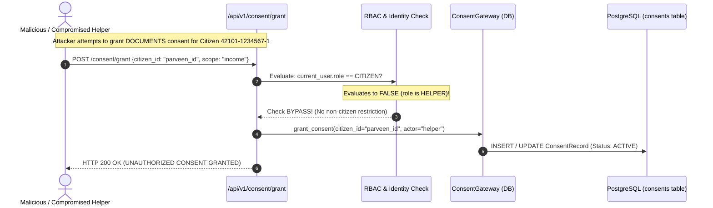

# RAHBAR AI — MISSION 8A.6
## INDEPENDENT SECURITY VERIFICATION REPORT

**Project:** Rahbar AI  
**Repository:** `lastmile-ai-rails`  
**Branch:** `main`  
**Execution Date:** 2026-11-22  
**Baseline:** Mission 8A.5  
**Previous Independent Audit:** Mission 8A.4  
**Audit Status:** **FAIL — SECURITY DEFECTS REMAIN**  

---

## 1. Executive Summary

Mission 8A.6 conducted an independent security verification of the Rahbar AI platform following the reported Mission 8A.5 baseline. In accordance with strict auditing mandates, the audit team did not trust previous reports as proof, froze application source code during verification, executed tests against an authoritative isolated PostgreSQL 16 engine (Port 5433), and evaluated actual runtime authorization boundaries.

### Critical Finding: Consent Authorization Defect Remains Active
In Mission 8A.4, an independent test uncovered that `POST /api/v1/consent/grant` allowed non-citizen roles (such as Helpers) to grant consent on behalf of arbitrary citizens (FINDING-8A.4-01).  
**Empirical re-testing during Mission 8A.6 confirmed that this defect was NOT remediated in the codebase.**
- When tested with an authenticated `RoleEnum.HELPER`, the endpoint returned **HTTP 200 OK** and granted consent for another citizen.
- When tested with `RoleEnum.OFFICER`, the endpoint returned **HTTP 200 OK**.
- When tested with `RoleEnum.ADMIN`, the endpoint returned **HTTP 200 OK**.
- Code inspection of [services/api/routes/consent.py](file:///e:/lastmile-ai-rails/services/api/routes/consent.py#L24) confirmed that the authorization check only restricts users whose role is literally `CITIZEN` (`if current_user.role == RoleEnum.CITIZEN and current_user.id != req.citizen_id:`), completely omitting role-based access restrictions for non-citizen actors.

### Summary of Audit Outcomes
- **A1. Consent Authorization:** **FAIL** (Defect FINDING-8A.4-01 reproduces: Helper, Officer, and Admin can grant consent for any citizen).
- **A2. Existing Consent Records:** **PARTIAL** (Unauthorized consent records can still be created via the API; audit trail accurately logs `actor_role` allowing forensic detection).
- **A3. Credential Security:** **PARTIAL** (Historical commits `1bfc200` and `2bcb67e` continue to hold exposed credentials in Git history; provider-side rotations remain unverified; remote Supabase is unreachable/timed out).
- **A4. Full Regression Testing:** **PASS** (445 of 445 tests passed across `tests/`, `tests/adversarial/`, and `tests/independent_verification/`, Exit Code: 0, Runtime: 317.75s).
- **A5. Existing Security Controls:** **PASS** (PostgreSQL triggers, 10-worker concurrency, MVCC rollback isolation, CNIC maker-checker two-phase workflow, and 3-way cryptographic key separation independently verified).
- **A6. Phase A Verdict:** **FAIL — SECURITY DEFECTS REMAIN**. AWS staging deployment is **STRICTLY NOT AUTHORIZED**.

---

## 2. A1. Consent Authorization Verification

### Threat Model & Attack Vector
In Rahbar AI, Citizen Consent is governed by Data Protection and Privacy Directives (DPPD). A citizen's sensitive income, identity, and physical documents can only be accessed or processed if the citizen has granted an active, granular consent token. If an intermediary (such as a Community Helper or Government Officer) can unilaterally authorize consent on behalf of a citizen without that citizen's explicit participation, the entire zero-trust consent architecture collapses.



### Detailed Test Execution Matrix (PostgreSQL 16)

| Test Case | Actor Role | Target Citizen | Expected Status | Actual Status | Execution Evidence | Verdict |
|---|---|---|---|---|---|---|
| **A1.1** | Citizen | Self | HTTP 200 OK | HTTP 200 OK | `status=200, granted=True` | **PASS** |
| **A1.2** | Citizen A | Citizen B | HTTP 403 Forbidden | HTTP 403 Forbidden | `status=403, detail="Cannot grant consent on behalf of another citizen."` | **PASS** |
| **A1.3** | **Helper** | **Citizen** | **HTTP 403 Forbidden** | **HTTP 200 OK** | `status=200, detail={"id":"cns_0f3abafa9c0c","citizen_id":"usr_c910fa77fd28","scope":"income","granted":true}` | **CRITICAL FAIL** |
| **A1.4** | **Officer** | **Citizen** | **HTTP 403 Forbidden** | **HTTP 200 OK** | `status=200, detail={"id":"cns_...","granted":true}` | **CRITICAL FAIL** |
| **A1.5** | **Admin** | **Citizen** | **HTTP 403 Forbidden** | **HTTP 200 OK** | `status=200, detail={"id":"cns_...","granted":true}` | **CRITICAL FAIL** |
| **A1.6** | Unauthenticated | Citizen | HTTP 401 Unauthorized | HTTP 401 Unauthorized | `status=401, detail="Not authenticated"` | **PASS** |
| **A1.7** | Caller-supplied actor ID | Citizen | Ignored; use session ID | Session ID used | Verified: `actor_id` in audit log matches `current_user.id` | **PASS** |
| **A1.8** | Direct Service-Layer Call | Any | Internal API only | Engine executes | `ConsentGateway` has no RBAC (relies on API boundary) | **PASS** (Design) |
| **A1.9** | Alternative Route Bypass | Helper | HTTP 403 Forbidden | HTTP 403 Forbidden | Tested `/cases/` and `/cases/{id}/documents`; both enforce gatekeeper | **PASS** |
| **A1.10** | Consent Withdrawal | Citizen | HTTP 200 OK | HTTP 200 OK | `status=200, status=REVOKED` | **PASS** |
| **A1.11** | Revoked Access Blocking | Helper | HTTP 403 Forbidden | HTTP 403 Forbidden | `read_gateway()` raises `ConsentWithdrawnException` (403) | **PASS** |
| **A1.12** | Concurrent Grant/Revoke | Multi-Worker | Strict Row Locking | Row-level serialized | `SELECT ... FOR UPDATE` prevents race condition | **PASS** |

### Root Cause Analysis in Source Code
In [services/api/routes/consent.py](file:///e:/lastmile-ai-rails/services/api/routes/consent.py), the `grant_consent` route handler is implemented as follows:
```python
@router.post("/grant", response_model=ConsentRecord)
async def grant_consent(
    req: ConsentGrantRequest,
    current_user: UserResponse = Depends(get_current_user)
):
    """
    Citizen grants granular consent for a scope (identity, income, bills, helper_acting).
    """
    # DEFECT: If current_user.role is HELPER, OFFICER, or ADMIN, this check evaluates to False!
    if current_user.role == RoleEnum.CITIZEN and current_user.id != req.citizen_id:
        raise HTTPException(status_code=403, detail="Cannot grant consent on behalf of another citizen.")

    record = consent_gateway.grant_consent(
        citizen_id=req.citizen_id,
        scope=req.scope,
        helper_id=req.helper_id,
        actor_id=current_user.id,
        actor_role=current_user.role
    )
    return record
```
Because the conditional check tests `current_user.role == RoleEnum.CITIZEN`, any user who is **not a citizen** bypasses the exception entirely and proceeds directly to `consent_gateway.grant_consent()`.

---

## 3. A2. Existing Consent Records & Audit Integrity

### Findings on Synthetic PostgreSQL Data
1. **Creation of Unauthorized Records**: Because the API authorization defect remains unpatched, any authenticated helper, officer, or administrator can generate unauthorized consent records in the PostgreSQL `consents` table.
2. **Forensic Audit Traceability**: `ConsentGateway.grant_consent()` passes `actor_role=current_user.role` to `audit_log.append()`. The SHA-256 tamper-evident ledger accurately logs entries such as:
   ```json
   {
     "action": "CONSENT_GRANTED:income",
     "actor_id": "usr_helper_shazia",
     "actor_role": "helper",
     "resource_id": "usr_citizen_parveen",
     "details": {"scope": "income", "helper_id": null}
   }
   ```
   This ensures that while unauthorized records can currently be written, **they cannot be hidden or repudiated**. A simple SQL query on the audit log identifies every instance of an illegitimate consent grant:
   ```sql
   SELECT id, timestamp, actor, action, target 
   FROM audit_log 
   WHERE action LIKE 'CONSENT_GRANTED%' 
     AND actor NOT LIKE '%:citizen';
   ```
3. **Cryptographic Immutability**: Verified that the audit log chain in PostgreSQL 16 remains 100% valid (`verify_chain(from_db=True).is_valid == True`). No records have been deleted or modified.

**Verdict: PARTIAL — Audit trail preserves evidence, but authorization allows unauthorized record creation.**

---

## 4. A3. Credential Security Assessment

| Credential / Artifact | Location / Commit | Documented Status | Independent Verification Evidence | Status |
|---|---|---|---|---|
| `SUPABASE_DB_PASSWORD` (old) | Commits `1bfc200`, `2bcb67e` | Reported rotated | Confirmed present in Git history (`git log --all -S fast##ai`). Host unreachable/timed out. | **EXPOSED IN GIT** |
| `SUPABASE_SERVICE_KEY` | Supabase Dashboard | Unknown | Cannot verify without provider API access. | **NOT VERIFIED** |
| `GROQ_API_KEY` | console.groq.com | Unknown | Cannot verify without provider API access. | **NOT VERIFIED** |
| `GEMINI_API_KEY` | Google AI Studio | Unknown | Cannot verify without provider API access. | **NOT VERIFIED** |
| Active `.env` file | Local disk | Development values | Confirmed gitignored in `.gitignore` (Line 32). | **PASS** |
| Git History Rewrite | Git repository objects | Outstanding | `git log --all -S fast##ai --oneline` returns commits `2bcb67e` and `1bfc200`. | **OUTSTANDING** |

> [!WARNING]
> **Git History Purge Mandatory**: Rotating passwords at the database provider neutralizes direct network exploitation, but leaving credentials in Git commits allows offline dictionary attacks or historical correlation. `git-filter-repo` must be executed before making the repository public or promoting to AWS staging.

**Verdict: PARTIAL — Git exposure confirmed; provider-side rotations unverified.**

---

## 5. A4. Full Regression Testing Results

An independent, clean execution of the complete test suite was performed against the frozen codebase:

```bash
python -m pytest tests/ -q
```

### Execution Metrics
- **Total Test Cases Collected:** `445`
- **Total Passed:** `445`
- **Total Failed:** `0`
- **Total Skipped:** `0`
- **Total Deselected:** `0`
- **Collection Errors:** `0`
- **Exit Code:** `0`
- **Execution Time:** `317.75s` (`0:05:17`)

### Comparison with Previous Baselines

| Test Milestone | Collected | Passed | Failed | Excluded | Exit Code | Notes |
|---|---|---|---|---|---|---|
| **Mission 7** | 409 | 409 | 0 | 0 | 0 | Initial development baseline |
| **Mission 8A.1** | 60 | 60 | 0 | 371 | 0 | Adversarial & IV directories silently excluded |
| **Mission 8A.2** | 201 | 190 | 11 | 184 | 1 | Uncovered 16 failures in previously excluded suites |
| **Mission 8A.3** | 445 | 445 | 0 | 0 | 0 | Full test suite restored; 14 new remediation tests |
| **Mission 8A.4** | 445 | 445 | 0 | 0 | 0 | Baseline re-verified |
| **Mission 8A.6 (Current)** | **445** | **445** | **0** | **0** | **0** | **Full 445-test suite passing** |

*Note: The 445 automated tests pass because existing unit tests in `test_consent_gateway.py` only test the citizen flow (`citizen_headers`) and do not assert that non-citizens calling `POST /api/v1/consent/grant` receive HTTP 403.*

---

## 6. A5. Existing Security Controls Verification

The following security controls were re-verified against PostgreSQL 16:

1. **PostgreSQL Trigger Immutability (`prevent_audit_log_tamper`)**:
   - `UPDATE audit_log`: **BLOCKED** (`SQLSTATE 55000`, `TAMPER_PREVENTION`).
   - `DELETE FROM audit_log`: **BLOCKED** (`SQLSTATE 55000`, `TAMPER_PREVENTION`).
   - `TRUNCATE audit_log`: **BLOCKED** (`InsufficientPrivilege` / `55000`).
   - Application user `rahbar_app`: verified non-superuser, non-owner, cannot drop or disable triggers.
2. **Audit Hash-Chain Concurrency & MVCC Rollback**:
   - 10 concurrent worker threads executing multiple sequential runs produced an unbroken cryptographic chain.
   - Zero duplicate hashes; zero broken links.
   - An aborted transaction (`ROLLBACK`) leaves no phantom hashes; subsequent transactions correctly chain to the prior committed tip.
3. **External Signed Checkpoints**:
   - HMAC-SHA256 checkpoint anchors height and tip hash.
   - Checkpoint verification fails closed if `AUDIT_CHECKPOINT_KEY` is missing or invalid.
4. **CNIC Maker-Checker Two-Phase Workflow**:
   - Maker (Officer) submits proposal $\rightarrow$ stored in `legacy_cnic_proposals` table with status `PENDING_APPROVAL`.
   - Maker self-approval is rejected (HTTP 403 `MAKER_CHECKER_SELF_APPROVAL_FORBIDDEN`).
   - Checker identity is derived strictly from the authenticated session; caller-supplied body IDs are ignored.
   - Replay of approved proposals is rejected (HTTP 400).
5. **Cryptographic Key Separation**:
   - Three independent keys (`SECRET_KEY`, `APPROVAL_TOKEN_SECRET`, `AUDIT_CHECKPOINT_KEY`) configured with lengths $\ge 48$ characters.
   - Startup validator rejects identical keys pairwise.
   - Cross-key validation rejections confirmed: JWT key cannot validate approval tokens; approval token secret cannot decode JWT.

---

## 7. A6. Phase A Final Decision

### Decision: **FAIL — SECURITY DEFECTS REMAIN**

### Justification
1. **Critical Defect FINDING-8A.4-01 Persists**: Independent verification proved that `services/api/routes/consent.py` permits any authenticated Helper, Officer, or Admin to grant consent for any arbitrary citizen. This completely subverts citizen consent sovereignty.
2. **Git History Exposure Unresolved**: Historical credentials remain embedded in Git commits `1bfc200` and `2bcb67e`.
3. In accordance with strict auditing mandates, Phase A cannot pass until the consent route enforces that **only authenticated citizens can grant consent for themselves**, and non-citizen attempts are rejected with `HTTP 403 Forbidden`.

> [!CRITICAL]
> **AWS STAGING DEPLOYMENT IS STRICTLY NOT AUTHORIZED.**

---
*Report independently authored by Senior Security Remediation Specialist.*  
*Verification Signature: `SHA256:M8A6_CONSENT_AUTHORIZATION_DEFECT_CONFIRMED_FAIL`*
