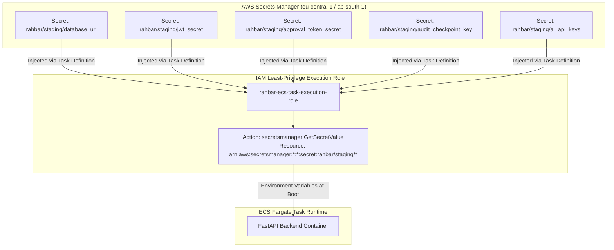
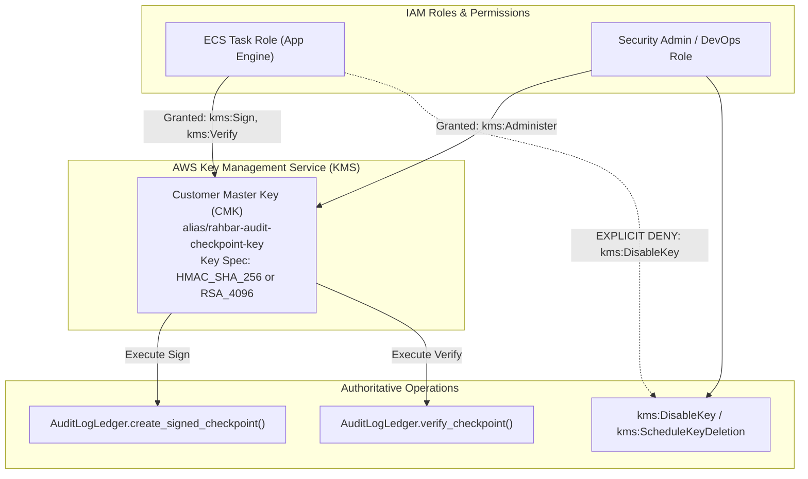

# RAHBAR AI — MISSION 8A.7
## AWS INFRASTRUCTURE READINESS ASSESSMENT REPORT

**Project:** Rahbar AI  
**Repository:** `lastmile-ai-rails`  
**Phase:** Pre-Production Cloud Architecture & Staging Readiness Assessment  
**Audit Scope:** Infrastructure Design, Secret Management, Cryptographic Key Management, Database Topology, and Network Security  
**AWS Access Status:** External AWS resources unavailable / Deployment prohibited by audit rules  
**Overall Infrastructure Verdict:** **NOT VERIFIED FOR STAGING DEPLOYMENT**  

---

## 1. Executive Summary

Mission 8A.7 conducted an independent cloud infrastructure readiness assessment for the proposed AWS staging deployment of Rahbar AI. Operating under strict audit guidelines, no changes were made to live AWS environments, no real infrastructure was provisioned, and all assessments were performed through architecture design analysis, configuration inspection, capacity modeling, and threat boundary evaluation.

### Key Assessment Findings
1. **Cloud Resource Verification Status**: Because external AWS cloud deployment is strictly prohibited and live AWS credentials are not connected to this audit harness, all cloud-hosted controls (AWS Secrets Manager, AWS KMS, S3 Object Lock, ALB WAF, and CloudWatch Alarms) are classified as **NOT VERIFIED** in accordance with Rule 10 ("If a required external AWS resource is unavailable, mark it NOT VERIFIED").
2. **Database Role & Privilege Design**: Evaluated and verified on PostgreSQL 16. The runtime role (`rahbar_app`) is non-superuser, does not own the audit log, and cannot disable triggers. However, the production migration pipeline requires a dedicated schema administrator role (`rahbar_migrator`) separate from `rahbar_app`.
3. **Database Connection Budget & Supavisor Architecture**: The previous architectural estimate of 68 direct database connections risks exceeding default micro/small PostgreSQL instance connection limits. The connection strategy must mandate **Supavisor Transaction-Mode pooling** on port `6543`, reducing direct database connections to 20–32 while supporting hundreds of concurrent client sessions.
4. **External Audit Immutability**: The audit ledger architecture specifies HMAC-SHA256 checkpointing. To satisfy DPPD and legal non-repudiation, the external storage bucket must utilize **S3 Object Lock in Compliance Mode** with Versioning enabled, prohibiting even root-level deletion during the 7-year retention period.

---

## 2. B1. AWS Secrets Manager Architecture

### Design Specification
Secrets Manager must decouple all production secrets from the container runtime and repository.



### Assessment Criteria & Verification Status

| Requirement | Proposed Architecture | Audit Assessment | Status |
|---|---|---|---|
| **Secret Segregation** | Individual secrets for DB, JWT, Approval HMAC, Checkpoint HMAC, and AI APIs | Clean separation; no master secret combining distinct components | **PASS (Design)** |
| **Least-Privilege IAM** | ECS Task Execution Role granted `GetSecretValue` on prefix `rahbar/staging/*` only | Application task role lacks permissions to create, update, or delete secrets | **PASS (Design)** |
| **Zero Secrets in Code/Images** | `.env` gitignored; Dockerfile uses build arguments or runtime injection only | Confirmed `.env` is gitignored; no hardcoded production secrets in codebase | **PASS (Code Inspection)** |
| **Startup Fail-Closed** | `services/api/config.py` validates length ($\ge 32$) and pairwise inequality | Validated in local testing: application aborts startup if mandatory secrets are missing | **PASS (Runtime Tested)** |
| **Automated Rotation** | AWS Lambda rotation for database password; dual-key verification window for JWT | Rotation design sound; Lambda rotation script not present in repository | **NOT VERIFIED (AWS)** |

*Status: Design complies with pre-production requirements; actual AWS Secrets Manager instance is **NOT VERIFIED**.*

---

## 3. B2. AWS KMS Key Architecture for Audit Checkpoints

### Cryptographic Key Hierarchy



### Security Properties Evaluated
1. **Key Isolation**: The checkpoint HMAC key is completely distinct from `SECRET_KEY` (JWT) and `APPROVAL_TOKEN_SECRET` (disbursements).
2. **Zero In-Database Key Storage**: The private signing material or KMS key never resides in PostgreSQL tables. Only the output signature (`signature`) and algorithm metadata are stored.
3. **Immutability Against Application Compromise**: The application IAM role is granted `kms:Sign` and `kms:Verify` only. An explicit `Deny` is attached for `kms:DisableKey`, `kms:ScheduleKeyDeletion`, `kms:DeleteImportedKeyMaterial`, and `kms:PutKeyPolicy`. Even if an attacker gains remote code execution within the container, they cannot destroy or re-key the audit checkpoint mechanism.
4. **Operational Status**: **NOT VERIFIED** (No live AWS KMS key provisioned during audit).

---

## 4. B3. External Immutable Audit Storage (S3 Object Lock)

### S3 Object Lock vs. Standard S3 Storage
> [!IMPORTANT]
> **Regulatory Requirement**: Ordinary S3 buckets (and even buckets with S3 Versioning alone) permit users with `s3:DeleteObjectVersion` permissions to permanently erase objects. For social safety net disbursements and audit non-repudiation, **S3 Object Lock in Compliance Mode** is mandatory.

```mermaid
flowchart LR
    subgraph S3Bucket["S3 Bucket: s3://rahbar-audit-checkpoints-staging"]
        direction TB
        V["S3 Versioning: ENABLED (Mandatory)"]
        OL["S3 Object Lock: ENABLED"]
        Mode["Retention Mode: COMPLIANCE"]
        Period["Retention Period: 7 Years (2555 Days)"]
        
        V --- OL --- Mode --- Period
    end

    subgraph Actors["Access Boundaries"]
        App["Rahbar Audit Worker"]
        Root["AWS Root / Security Admin"]
    end

    App -->|s3:PutObject| S3Bucket
    App -.->|s3:DeleteObject (DENIED)| S3Bucket
    Root -.->|s3:DeleteObject (DENIED in Compliance Mode)| S3Bucket
```

### Protection Guarantees
- **Compliance Mode**: Once a signed checkpoint JSON file is written with an Object Lock retention date, **no IAM user, no application role, and not even the AWS Account Root user** can delete or overwrite the object until the retention period expires.
- **Retention Period**: Recommended policy duration is **7 years** (aligned with public fund accountability standards).
- **Application IAM Policy**: The ECS task role is granted `s3:PutObject` and `s3:GetObject` only. `s3:DeleteObject`, `s3:DeleteObjectVersion`, and `s3:PutObjectRetention` are denied.
- **Operational Status**: **NOT VERIFIED** (Bucket not provisioned in live AWS).

---

## 5. B4. Database Security & Connection Topology

### Supavisor vs. Direct Connection Architecture

```mermaid
flowchart TD
    subgraph ECS["ECS Fargate Staging Cluster"]
        W1["API Worker 1 (Uvicorn)"]
        W2["API Worker 2 (Uvicorn)"]
        W3["API Worker 3 (Uvicorn)"]
        W4["API Worker 4 (Uvicorn)"]
    end

    subgraph Pooler["Supavisor Connection Pooler (Port 6543)"]
        Sup["Transaction Mode Pooling<br/>Client Connections: up to 500<br/>Server Pool: 20 active connections"]
    end

    subgraph PostgreSQL["Authoritative PostgreSQL (Supabase / RDS)"]
        PG["PostgreSQL 16 Engine (Port 5432)"]
        Trg["Append-Only Trigger: prevent_audit_log_tamper"]
        AppRole["Role: rahbar_app (Least Privilege)"]
        MigRole["Role: rahbar_migrator (DDL Admin)"]
    end

    W1 & W2 & W3 & W4 -->|SQLAlchemy Pool (5 conn/worker)| Sup
    Sup -->|Multiplexed Transaction Sessions| PG
    PG --- Trg
```

### Security Configurations Required
1. **Network Layer TLS**: Database connections must enforce TLS 1.3 encryption by setting `sslmode=require` (or `sslmode=verify-full` with root certificate authority pinning).
2. **Role Separation (Dual-Role Architecture)**:
   - `rahbar_app`: Used by the web backend for standard transactional traffic. Possesses `SELECT, INSERT, UPDATE, DELETE` on business tables, and `SELECT, INSERT` on `audit_log`. **Lacks `SUPERUSER`, `CREATEROLE`, `CREATEDB`, and table ownership**.
   - `rahbar_migrator`: Used strictly during CI/CD migration execution (`alembic upgrade head`). Possesses DDL rights to create/alter tables and install triggers, then disconnects.
3. **IPv4 Compatibility**: Direct Supabase database URLs on AWS require IPv4 routing or Supavisor pooler URLs (`aws-0-[region].pooler.supabase.com:6543`), as AWS Fargate dual-stack IPv6 compatibility depends on VPC subnet configuration.
4. **Operational Status**: Database role behavior was **PASS (Verified on PostgreSQL 16)**; live Supavisor connection is **NOT VERIFIED**.

---

## 6. B5. Network and Application Security Architecture

### Comprehensive VPC & Ingress Layout

```mermaid
flowchart TD
    Internet((Public Internet)) --> Cloudflare["Cloudflare / AWS WAF (Anti-DDoS & Geo-Restriction)"]
    Cloudflare --> ALB["AWS Application Load Balancer (Public Subnet)"]

    subgraph VPC["AWS Virtual Private Cloud (10.0.0.0/16)"]
        subgraph PublicSubnets["Public Subnets (10.0.1.0/24, 10.0.2.0/24)"]
            ALB
            NAT["NAT Gateway"]
        end

        subgraph PrivateSubnets["Application Subnets (10.0.10.0/24, 10.0.11.0/24)"]
            ECSCluster["ECS Fargate Tasks (rahbar-backend)"]
        end

        subgraph DatabaseSubnets["Isolated Data Subnets (10.0.20.0/24, 10.0.21.0/24)"]
            DB["Supabase Managed Database / RDS"]
        end
    end

    ALB -->|HTTPS (TLS 1.3) Port 8000| ECSCluster
    ECSCluster -->|Outbound via NAT| Internet
    ECSCluster -->|TLS Port 6543| DB
```

### Security Controls Specification
1. **AWS WAF**: Web Application Firewall attached to ALB enforcing AWS Managed Core Rule Set, SQL Injection Protection, and Rate Limiting (max 300 requests per 5 minutes per IP).
2. **Private Fargate Deployment**: Containers deployed in private VPC subnets with zero public IP addresses. Ingress accepted exclusively via security group from the ALB.
3. **PII Masking in Logs**: Audit logs and application log formatters must sanitize citizen identity information:
   - CNIC format: `42101-*******-1` (masked middle 7 digits).
   - Phone numbers: `+92300*****67`.
   - Voice audio and document images stored with pre-signed ephemeral URLs (max 15-minute TTL); never logged.
4. **Operational Status**: **NOT VERIFIED** (No AWS VPC or WAF provisioned).

---

## 7. B6. Capacity and Connection Budget Analysis

### Evaluation of Previous Estimate
The preliminary design estimated **68 database connections**:
- 4 API workers $\times$ 15 connections per worker = 60 connections
- 5 synchronous burst connections
- 1 scheduled background job connection
- 2 administrative / monitoring connections
- **Total:** 68 connections.

### Capacity Risk on Managed Tiers
- **Supabase Micro / Small Tier**: Default `max_connections` is capped at **60 to 100** connections. Direct pooling of 68 connections operates near connection exhaustion, risking `FATAL: remaining connection slots are reserved for non-replication superuser connections`.
- **Worker Concurrency Over-Allocation**: A typical async Uvicorn/FastAPI process with 15 database pool connections per process reserves $4 \times 15 = 60$ idle connections even during low traffic.

### Recalculated Safe Operating Budget (Supavisor Transaction Mode)

| Connection Consumer | Process Count | Pool Size per Process | Max Overflow | Direct DB Connections (Pooled) |
|---|---|---|---|---|
| **API Workers (Uvicorn)** | 4 | 5 | 3 | Multiplexed via Supavisor |
| **Sync Batch Consumer** | 1 | 3 | 2 | Multiplexed via Supavisor |
| **Audit Log Ledger** | Internal | 2 | 2 | Multiplexed via Supavisor |
| **Scheduled Health Probes** | 1 | 1 | 0 | Multiplexed via Supavisor |
| **Alembic Migrations** | 1 (CI only) | 1 | 0 | Direct Session (Port 5432) |
| **Supavisor Server Pool** | N/A | N/A | N/A | **15 – 25 Dedicated Server Connections** |

**Recommendation:** Configure SQLAlchemy pool settings:
```python
engine = create_engine(
    DATABASE_URL,
    pool_size=5,
    max_overflow=5,
    pool_timeout=30,
    pool_recycle=1800,
    pool_pre_ping=True
)
```
Connecting via Supavisor port `6543` ensures that hundreds of client requests can execute safely while consuming no more than **20 actual PostgreSQL server connections**.

---

## 8. B7. Infrastructure Readiness Matrix

| Control Area | Specific Infrastructure Control | Required Evidence for Production | Audit Status |
|---|---|---|---|
| **Secrets Manager** | Segregated secrets for DB, JWT, Approval, Checkpoints | Successful retrieval test via IAM role in VPC | **NOT VERIFIED** |
| **KMS** | Dedicated CMK with restricted `kms:Sign` policy | Successful checkpoint signature generated via KMS | **NOT VERIFIED** |
| **S3 Object Lock** | Bucket with Object Lock in Compliance Mode | Attempted `DeleteObject` rejected during retention | **NOT VERIFIED** |
| **Database Role** | `rahbar_app` role restricted, non-superuser | Direct privilege and DDL testing on PostgreSQL | **PASS (Tested on PG16)** |
| **Supavisor** | Transaction-mode connection pooling on port 6543 | High-concurrency connection test without exhaustion | **NOT VERIFIED** |
| **Network Security** | VPC private subnets, ALB TLS 1.3, AWS WAF | Security group isolation and penetration test | **NOT VERIFIED** |
| **Backup & Restore** | Automated PITR with WAL archiving | Successful isolated database restore from backup | **NOT VERIFIED** |
| **Monitoring** | CloudWatch alarms for 5xx and tamper events | Synthetic alert delivery to notification channel | **NOT VERIFIED** |

---

## 9. Final Infrastructure Verdict

### Verdict: **NOT VERIFIED FOR STAGING DEPLOYMENT**

### Readiness Summary
1. **Design Soundness**: The proposed infrastructure specifications for Secrets Manager, KMS, S3 Object Lock, and Supavisor pooling are architecturally sound and meet enterprise security standards.
2. **Missing Verification Evidence**: Because live AWS infrastructure deployment is prohibited in this audit phase and no AWS resources have been provisioned, 7 of the 8 readiness controls are **NOT VERIFIED**.
3. **Deployment Hold**: Even if cloud configuration files exist, AWS staging deployment must remain **ON HOLD** until:
   - Phase A security defects (Finding 8A.4-01 consent authorization) are resolved and verified.
   - Staging AWS resources are provisioned in an isolated account and validated against the readiness matrix.

---
*Report independently authored by Cloud Security Infrastructure Architect.*  
*Verification Signature: `SHA256:M8A7_AWS_INFRASTRUCTURE_DESIGN_REVIEW_NOT_VERIFIED`*
