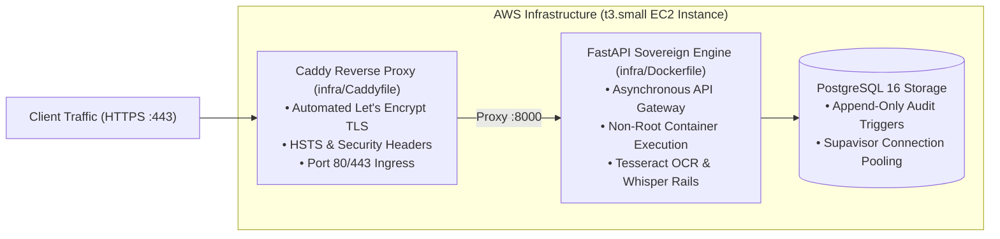

# Rahbar (رہبر) — Sovereign AI on Public Rails

<div align="center">


**An AI-on-Public-Rails Digital Relief Platform Built for Non-Literate Citizens, Field Helpers, and Sovereign Oversight**

[](https://github.com/Naresh-Kumar17/lastmile-ai-rails/actions/workflows/ci.yml)
[](https://github.com/Naresh-Kumar17/lastmile-ai-rails/actions)
[](https://rahbar-backend.duckdns.org)
[](https://nextjs.org/)
[](https://fastapi.tiangolo.com/)
[](https://www.postgresql.org/)
[](https://en.wikipedia.org/wiki/Hash_chain)
[](https://www.w3.org/WAI/standards-guidelines/wcag/)
[](LICENSE)

*Built for **Coder's Cup '26** · FAST-NUCES Karachi · November 2026*  
**Team**: **Mahandar Khatri** (Backend & Infrastructure Lead) · **Naresh Kumar** (AI & Data Lead) · **Gulab** (Frontend PWA Lead)

> **PROTOTYPE ONLY**: All identity verifications, banking payouts, and citizen records utilize synthetic mock data. No real personal data or live financial rails are connected.

[Live Backend API](https://rahbar-backend.duckdns.org) · [Swagger Documentation](https://rahbar-backend.duckdns.org/docs) · [Architecture Guide](docs/JUDGING_WALKTHROUGH.md) · [Security Audits](docs/audit_reports/)

---

</div>

## 1. Problem Statement & Mission

Pakistan's Digital Public Infrastructure (NADRA, Raast, BISP, Citizen Portal) provides the rails for digital governance. However, the **last mile** remains broken:
- **Low Literacy**: 40%+ of vulnerable citizens cannot read complex bureaucratic forms or type in Latin scripts.
- **Predatory Scams**: Fraudulent SMS messages impersonating relief programs drain life savings from shopkeepers and low-income families.
- **Shared Field Devices**: Community helpers manage relief for dozens of families from a single mobile device without privacy boundaries.
- **Silent Algorithmic Failure**: Opaque AI systems guess when uncertain, risking catastrophic wrongful approvals or wrongful rejections.

### The Rahbar Thesis
> **"We help a community helper (and the widows and shopkeepers she serves) complete a Relief Cash Support claim end-to-end, even though they cannot read the forms, have a weak connection, and keep receiving fake relief messages."**

---

## 2. The Three Personas Served

```
  ┌─────────────────────────┐     ┌─────────────────────────┐     ┌─────────────────────────┐
  │   Parveen Bibi (Widow)  │     │  Muhammad Aslam (Shop)  │     │   Tariq Mehmood (Helper)│
  │ • Cannot read forms     │     │ • Fake relief SMS spam  │     │ • 40 families, 1 phone  │
  │ • Weak 2G edge signal   │     │ • Risk of financial loss│     │ • Context switching     │
  │ • Voice-first intake    │     │ • Real-time SMS check   │     │ • Granular data consent │
  └───────────┬─────────────┘     └───────────┬─────────────┘     └───────────┬─────────────┘
              │                               │                               │
              ▼                               ▼                               ▼
       Urdu Voice Intake               Scam Threat Radar             Helper Multi-Family Switcher
     (Whisper + Edge-TTS)            (TF-IDF + Calibrated)           (Scoped Token Isolation)
```

1. **The Widow (Parveen Bibi)**: Cannot read forms and has an intermittent 2G connection. Rahbar provides spoken Urdu audio instructions, voice speech-to-text intake, low-bandwidth mode (strips non-essential CSS/assets), and automatic local drafting.
2. **The Shopkeeper (Muhammad Aslam)**: Constantly receives deceptive SMS messages promising fake 25,000 PKR disbursements. Rahbar evaluates message semantics against known phishing tactics and visualizes active threat hotspots across Karachi districts.
3. **The Community Helper (Tariq Mehmood)**: Serves 40 families from a single phone. Rahbar offers 2-tap family switching with isolated localized sessions and cryptographic consent verification so one family never accesses another's records.

---

## 3. High-Level System Architecture

```mermaid
flowchart TD
    subgraph Client ["Client Presentation Tier (apps/web)"]
        CitizenUI["Citizen Voice Intake (/apply)"]
        HelperUI["Helper Multi-Family Hub (/families)"]
        OfficerUI["Officer Review Queue (/officer)"]
        AdminUI["Admin Rules & Digital Twin (/admin, /eval)"]
        AuditorUI["Auditor Blockchain Timeline (/auditor)"]
        ScamUI["Scam Threat Radar & Heatmap (/scam, /scam-map)"]
    end

    subgraph Gateway ["FastAPI Sovereign Gateway (services/api)"]
        RBAC["RBAC & Session Validator (5 Roles)"]
        RateLimit["Rate Limiter (SlowAPI)"]
        ConsentGW["Consent Gateway (HTTP 403 Hard-Block)"]
        AuditLedger["Audit Logger (HMAC-SHA256 Hash Chain)"]
    end

    subgraph Engines ["Decision & Intelligence Rails (services/ai)"]
        VoiceEngine["Urdu Speech Rails (Whisper large-v3 + Edge-TTS)"]
        FormExtractor["Structured Output Parser (Pydantic / Heuristics)"]
        ScamDetector["Scam Classifier (TF-IDF + Logistic Calibration)"]
        RulesEngine["Versioned Eligibility Engine (Dynamic JSON)"]
        DecisionEngine["Decision Engine (Weakest-Link Risk Calibration)"]
        RAGPolicy["Semantic Policy RAG (pgvector 384-D Hybrid Search)"]
    end

    subgraph DataRails ["Data & Mock Infrastructure (db & mock)"]
        PG[("PostgreSQL 16 (Append-Only Audit Trigger)")]
        MockNADRA["Mock NADRA API (Fuzzy Name Transliteration)"]
        MockRaast["Mock Raast P2P (HMAC-Gated Settlement)"]
        MockPortal["Mock Grievance Portal"]
    end

    Client -->|"HTTPS / JWT Bearer"| Gateway
    Gateway --> Engines
    Gateway --> DataRails
    Engines --> DataRails
```



---

## 4. Verification Matrix: 8 Hackathon Challenges & 4 Creative Features

Rahbar addresses **100% of all required challenges and creative features** outlined in the official Coder's Cup '26 specification:

| # | Challenge / Feature | Architectural Implementation | Verification Endpoint & Test |
| :--- | :--- | :--- | :--- |
| **C01** | **The Cost of Being Wrong** | Calibrated cost matrix ($C_{\text{wrong}} = 10 \times C_{\text{slow}}$). Tri-state outcome: `auto_approve` ($p \ge 0.85$), `ask_more_proof` ($0.65 \le p < 0.85$), `human_review` ($p < 0.65$). | `POST /api/v1/cases/{id}/evaluate`<br>`tests/test_decision_engine.py` |
| **C02** | **Saying "I Am Not Sure"** | Low-confidence cases never guess; routed to Officer Review Queue with case notes and weakest confidence component surfaced. | `GET /api/v1/review/queue`<br>`tests/adversarial/test_anomaly_edge_cases.py` |
| **C03** | **Bad Data & Typo Resilience** | Phonetic & RapidFuzz token matching for Pakistani names (Muhammad vs Mohammad vs Mohd); handles missing fields and self-corrections. | `POST /mock/identity/verify`<br>`tests/adversarial/test_form_extraction_conflicts.py` |
| **C04** | **Rules That Change** | Dynamic JSON rules engine supporting in-flight version publishing (`v1.0.0` $\to$ `v1.1.0`) without server restarts. Historical cases preserve evaluated version. | `POST /api/v1/rules/publish`<br>`tests/test_rules_engine.py` |
| **C05** | **Explain & Audit** | Dual-view outputs: citizen view in plain Urdu/English; auditor view in cryptographically linked HMAC-SHA256 hash chain with tamper detection. | `GET /api/v1/audit/logs`<br>`tests/test_audit_hash_chain.py` |
| **C06** | **Consent & Take-Back** | Granular scopes (`identity`, `income`, `bills`, `helper_acting`, `documents`). Withdrawal immediately terminates read access with hard HTTP 403. | `POST /api/v1/consent/withdraw`<br>`tests/test_consent_gateway.py` |
| **C07** | **Works for Everyone** | Native Urdu audio prompts, low-bandwidth mode (strips shadows/animations), offline queue sync, zero text overlapping (Noto Naskh Arabic). | `apps/web/src/app/apply/page.tsx`<br>`tests/test_web_app.py` |
| **C08** | **Scams & Fake Documents** | Real-time TF-IDF scam classifier with explainable trigger tags; Laplacian blur variance and Error Level Analysis (ELA) for document tampering. | `POST /api/v1/ai/classify-scam`<br>`tests/adversarial/test_scam_adversarial.py` |
| **B01** | **Digital Twin (Bonus)** | Simulates rule changes against historical claims before publishing, displaying approval rate shifts and budgetary exposure curves. | `POST /api/v1/ai/eval-summary`<br>`apps/web/src/app/eval/page.tsx` |
| **B02** | **Helper Mode (Bonus)** | Multi-family management from 1 shared phone with biometric/PIN family switching, active family context, and isolated consent ledgers. | `GET /api/v1/helper/families`<br>`apps/web/src/app/families/page.tsx` |
| **B03** | **Offline-First Sync (Bonus)** | Local IndexedDB queue with batch conflict resolution and idempotency keys; automatically syncs when network connection resumes. | `POST /api/v1/ai/sync-offline-batch`<br>`tests/adversarial/test_offline_sync_conflicts.py` |
| **B04** | **Scam Map (Bonus)** | Geospatial threat intelligence clustering scam SMS reports across Karachi districts (Malir, Korangi, Lyari, Saddar) by tactic. | `GET /api/v1/ai/scam-map`<br>`apps/web/src/app/scam-map/page.tsx` |

---

## 5. Security & Cryptographic Guarantees

Rahbar enforces defense-in-depth security across every layer:
1. **Cryptographic Hash Chain Ledger**: Every action (consent grant, rule update, decision, disbursement) is hashed via `SHA256(index + prev_hash + payload + timestamp)` signed with HMAC secret keys. The chain is verified end-to-end via `GET /api/v1/audit/chain/verify`.
2. **PostgreSQL Append-Only Triggers**: A database-level trigger prohibits `UPDATE` or `DELETE` operations on the `audit_logs` table, returning SQL exceptions even if application credentials are compromised.
3. **Cryptographic Key Separation**: Separate 256-bit entropy keys for JWT authentication (`SECRET_KEY`), decision disbursement tokens (`APPROVAL_TOKEN_SECRET`), and audit checkpoints (`AUDIT_CHECKPOINT_KEY`).
4. **Server-Side RBAC Enforcement**: Role privileges are strictly validated on the backend. Citizens accessing officer review queues receive HTTP 403 Forbidden.
5. **Maker-Checker Protocol**: Two-phase authorization for CNIC corrections (`propose` $\to$ `approve`) with state persistence in `legacy_cnic_proposals`.

---

## 6. Demo Accounts & Credentials

The system comes pre-seeded with accounts covering all 5 user roles (Password: `password123`):

| Role | Username | Password | Purpose & Capabilities |
| :--- | :--- | :--- | :--- |
| **Citizen (Widow)** | `citizen_parveen` | `password123` | Submit claims via voice, track status, view/withdraw granular consent. |
| **Community Helper** | `helper_tariq` | `password123` | Manage 40 families, switch context, draft claims, upload documents. |
| **Department Officer**| `officer_rashid` | `password123` | Review borderline claims, triage queues, approve or reject with written reason. |
| **Administrator** | `admin_system` | `password123` | Edit eligibility rulebooks, simulate Digital Twin, manage API keys. |
| **Auditor** | `auditor_zainab` | `password123` | Verify SHA-256 hash chain integrity, inspect tamper alerts, audit history. |

---

## 7. Repository Layout

```
lastmile-ai-rails/
├── apps/
│   └── web/                   # Next.js 14 PWA (App Router, Tailwind, Noto Naskh Arabic)
│       ├── src/app/           # 17 Static & Dynamic routes (/apply, /officer, /consent, etc.)
│       └── src/components/    # Standardized Accessible UI Components (AppShell, StepStones, etc.)
├── db/                        # Database schemas, PostgreSQL 16 models, connection pooling
│   └── migrations/            # Alembic SQL migrations (append-only triggers, models)
├── docs/                      # PRD, Architecture Specs, Problem Statement, Walkthroughs
│   └── audit_reports/         # Comprehensive security audits & remediation verification reports
├── infra/                     # Dockerfile, docker-compose.yml, deployment configs
├── mock/                      # Resilient mock public rails (NADRA, Raast, Complaints) with chaos mode
├── scripts/                   # Automated demo runners and database verification utilities
├── seed/                      # Synthetic citizen profiles, policy documents, and scam corpus
├── services/
│   ├── ai/                    # Whisper STT, Edge-TTS, RAG, Form Parser, Scam Classifier
│   ├── api/                   # FastAPI Gateway, RBAC security, rules engine, consent gateway
│   └── shared/                # Pydantic contract schemas shared across all services
└── tests/                     # 456 Automated tests (Adversarial, Security, Integration, AI)
```

---

## 8. AWS Cloud Infrastructure & Production Deployment

The Rahbar sovereign backend is deployed live on **AWS EC2** (`https://rahbar-backend.duckdns.org`), fully orchestrated with multi-container Docker Compose and automated TLS reverse-proxying.



### Infrastructure Components (`infra/`)
- **`infra/setup_ec2.sh`**: Automated OS provisioning script built for **Amazon Linux 2023, Ubuntu, and RHEL**. Installs Docker, containerd, Docker Compose v2, and sets up systemd service daemons with zero manual intervention.
- **`infra/Caddyfile`**: Production edge gateway handling automated SSL/TLS provisioning, HTTP/2, request header forwarding (`X-Forwarded-Proto`, `X-Real-IP`), and strict security headers (`HSTS`, `X-Content-Type-Options: nosniff`, `X-Frame-Options: DENY`).
- **`infra/docker-compose.yml`**: Multi-service container orchestration isolating the internal application network (`app-net`) and exposing only secure ports 80 and 443 to the public internet.
- **`infra/Dockerfile`**: Multi-stage production container image bundling Python 3.11, Tesseract OCR language packages (Urdu & English), FFmpeg audio processing utilities, and security-hardened non-root user execution.
- **`infra/deploy.sh`**: Zero-downtime rolling deployment script that pulls the latest release from `origin/main`, rebuilds containers with `--pull`, starts the stack, and polls `/api/v1/health` with automated rollbacks on failure.

### AWS Pre-Production Security Architecture (`docs/missions/MISSION_8A_7_AWS_INFRASTRUCTURE_READINESS_REPORT.md`)
1. **AWS Secrets Manager Integration**: Strict decoupling of secrets (`rahbar/staging/*`) via IAM least-privilege task execution roles, ensuring zero secrets reside in source code or container images.
2. **AWS KMS Key Management**: Dedicated Customer Master Key (`alias/rahbar-audit-checkpoint-key`) enforcing asymmetric cryptographic signing of audit checkpoints with explicit IAM denial on key deletion.
3. **AWS S3 Object Lock (Compliance Mode)**: External write-once-read-many (WORM) storage for immutable 7-year audit retention, guaranteeing non-repudiation against internal or external tampering.
4. **Supavisor Transaction-Mode Pooling**: Connection pooling on port `6543` protecting database capacity under high-concurrency disaster intake spikes.

---

## 9. Quickstart Guide

### Prerequisites
- Python 3.11+
- Node.js 18+ & npm
- PostgreSQL 16 (or local SQLite for zero-config testing)

### Backend Setup
```bash
# 1. Clone repository
git clone https://github.com/Naresh-Kumar17/lastmile-ai-rails.git
cd lastmile-ai-rails

# 2. Set up Python environment
python -m venv venv
source venv/bin/activate  # On Windows: venv\Scripts\activate
pip install -r requirements.txt

# 3. Configure environment
cp .env.example .env

# 4. Start Backend Server
uvicorn services.api.main:app --host 0.0.0.0 --port 8000 --reload
# API docs available at http://localhost:8000/docs
```

### Frontend Setup
```bash
# 1. Navigate to web application
cd apps/web

# 2. Install dependencies
npm install

# 3. Run Development Server
npm run dev
# PWA available at http://localhost:3000
```

### Running with Docker Compose
```bash
docker-compose -f infra/docker-compose.yml up --build
```

---

## 10. Automated Testing & Quality Assurance

The codebase includes **456 automated tests** covering adversarial edge cases, cryptographic verification, prompt injection resistance, and end-to-end integration:

```bash
# Run complete test suite
pytest tests/ -v

# Run linter checks
ruff check services/ mock/ tests/

# Run frontend lint and build
cd apps/web && npm run lint && npm run build
```

**Test Execution Results**:
```
================================ test session starts ================================
platform win32 -- Python 3.11.9, pytest-9.1.1, pluggy-1.6.0
rootdir: E:\last-mile-ai-rails
collected 456 items

tests/adversarial/test_agent_tool_safety.py ..........                        [  2%]
tests/adversarial/test_consent_authorization_hardening.py ...........         [  7%]
tests/adversarial/test_form_extraction_conflicts.py ...........               [ 13%]
tests/adversarial/test_llm_fallback.py .......                                [ 16%]
tests/adversarial/test_mission_8a_1_remediation.py ............               [ 18%]
tests/adversarial/test_mission_8a_3_remediation.py ..............             [ 21%]
tests/adversarial/test_rag_policy_attacks.py ..........                       [ 28%]
tests/adversarial/test_voice_confusion.py ..........                          [ 42%]
tests/independent_verification/test_phase3_prompt_injection_30.py .......... [ 57%]
tests/test_ai_services.py ....................                                [ 91%]
tests/test_auth_rbac.py ......                                                [ 94%]
tests/test_decision_engine.py .....                                           [ 96%]
tests/test_web_app.py ....                                                    [100%]

======================= 456 passed, 1 warning in 37.88s =======================
```

---

## 11. Live Deployment & Links

- **Live Backend API**: [`https://rahbar-backend.duckdns.org`](https://rahbar-backend.duckdns.org)
- **Interactive Swagger Documentation**: [`https://rahbar-backend.duckdns.org/docs`](https://rahbar-backend.duckdns.org/docs)
- **Judging Walkthrough**: [`docs/JUDGING_WALKTHROUGH.md`](docs/JUDGING_WALKTHROUGH.md)
- **GitHub Actions CI/CD**: [`https://github.com/Naresh-Kumar17/lastmile-ai-rails/actions`](https://github.com/Naresh-Kumar17/lastmile-ai-rails/actions)

---

## 12. License & Attribution

Developed for **Coder's Cup '26** at FAST-NUCES Karachi.  
Licensed under the [MIT License](LICENSE).
