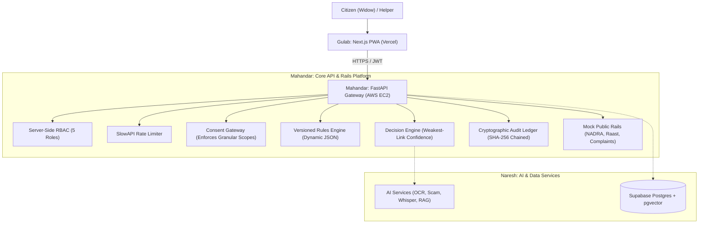

# Rahbar (رہبر): AI on Public Rails
**Digital Public Infrastructure (DPI) Prototype for The Last Mile**  
**Event:** Coder's Cup '26 · Hagrid's Hackathon · FAST-NUCES Karachi  
**Team:** 
- **Mahandar Khatri** (Backend Lead & AWS Infrastructure)
- **Naresh Kumar** (Agents, AI & Supabase Data Platform)
- **Gulab** (Frontend Lead & Mobile PWA)

> **PROTOTYPE ONLY.** Every identity, payment, and data service is simulated. No real personal data anywhere.

---

## 1. The One Sentence
> **We help a community helper (and the widows and shopkeepers she serves) apply for a mock Relief Cash Support claim, even though they cannot read the forms, have a weak connection, and keep receiving fake relief messages.**

### Why This Task?
One deep, production-grade task beats multiple thin superficial ones. A relief cash grant naturally touches all **eight hackathon challenges**:
1. **The Cost of Being Wrong:** Wrong approvals cost 10x more than slow approvals. A calibrated cost matrix strictly gates disbursements ($p_{\text{wrong}} \le 0.05$).
2. **Saying "I Am Not Sure":** Low-confidence decisions never guess silently; they route to a human officer with a comprehensive handoff packet.
3. **Bad Data:** Real-world Pakistani names with spelling variants (e.g., *Muhammad / Mohammad / Mohd*), typos, and missing fields are resolved safely without incorrect mergers.
4. **Rules That Change:** Admins can publish new versioned eligibility rules without code redeployment or server restarts.
5. **Explain and Audit:** Dual-view explainability (plain Urdu/English with voice cues for citizens; full parameter trace for auditors) backed by a SHA-256 hash-chained audit ledger.
6. **Consent and Take-Back:** Granular consent scopes (`identity`, `income`, `bills`, `helper_acting`) enforced by a server-side Consent Gateway; revocation immediately blocks access (HTTP 403).
7. **Works for Everyone:** Low-literacy UI with voice input, audio playback cues, and offline queue resilience.
8. **Scams and Fake Documents:** Scikit-Learn calibrated classifier detects fraudulent relief SMS messages; blur and tamper scoring flags altered documents.

---

## 2. Real vs. Simulated DPI Matrix
As required by the hackathon rubric, here is the transparent breakdown of real production logic vs simulated public rails:

| Rail / Capability | Real Implementation | Simulated / Prototype Mock | Justification & Hackathon Rubric |
| :--- | :--- | :--- | :--- |
| **Identity Verification** | Fuzzy transliteration & RapidFuzz token matching | Mock NADRA API (`/mock/identity/verify`) with chaos injection | Real NADRA requires government credentials; simulated with realistic Pakistani names & CNICs. |
| **Disbursement / Payment** | Gated approval token check, idempotency keys, hash auditing | Mock Raast Instant Payment (`/mock/payment/disburse`) | Real Raast requires State Bank of Pakistan banking license. |
| **Grievance System** | Hash-chained case tracking & status log | Mock Citizen Portal (`/mock/complaints`) | Safe sandbox without spamming public grievance lines. |
| **Decision Rules** | **REAL** Deterministic Python/Pydantic rules engine | None | 100% reproducible and auditable without hallucination. |
| **Decision Cost Matrix** | **REAL** Calibrated thresholds ($p_{\text{wrong}} \le 0.05$) | None | Demonstrates deep understanding of DPI risk trade-offs. |
| **Cryptographic Audit** | **REAL** SHA-256 hash-chained ledger & tamper detection | None | Production-grade verifiable digital trail for public transparency. |
| **Consent Enforcement** | **REAL** Server-side Consent Gateway with 403 block | None | Real-time privacy protection. |
| **AI LLM Router** | **REAL** Multi-tier fallback (Groq Llama-3.3-70B/Qwen $\to$ Gemini $\to$ Offline) | None | High speed, cost optimization, and live demo reliability. |
| **Urdu Voice Pipeline** | **REAL** Whisper large-v3 STT + edge-tts Urdu synthesis | None | Voice-first accessibility for non-literate citizens. |
| **Scam Detection** | **REAL** Calibrated Logistic Regression + TF-IDF with explainable tags | None | Protects shopkeepers against fake relief payment SMS scams. |

---

## 3. Conflict-Free Repository Ownership
To ensure **zero Git merge conflicts**, the repository ownership is strictly partitioned:

```
rahbar/
├── services/
│   ├── api/                 # [MAHANDAR] FastAPI gateway, routes, RBAC, rules engine, consent gateway, decision engine
│   ├── ai/                  # [NARESH] LiteLLM router, scam classifier, OCR pipeline, voice STT/TTS, RAG, LangGraph
│   └── shared/              # [SHARED CONTRACT] Frozen Pydantic schemas (case, decision, error, AI signatures)
├── mock/                    # [MAHANDAR] Mock external services (NADRA, Raast, Complaints) with chaos switches
├── infra/                   # [MAHANDAR] AWS EC2 Dockerfile, docker-compose.yml, Caddyfile, deploy scripts, systemd
├── db/                      # [NARESH] Supabase Postgres setup, Alembic migrations, database models
├── seed/                    # [NARESH] Synthetic citizens, scam messages, mock ID/bill images, policy PDFs
├── apps/
│   └── web/                 # [GULAB] Next.js PWA, Tailwind, shadcn, Urdu RTL, PWA service worker
├── docs/                    # [SHARED] PRD, openapi.json, slides, architecture notes
├── tests/                   # [MAHANDAR & SHARED] Automated unit and integration test suite
├── .github/workflows/ci.yml # [MAHANDAR] Automated GitHub Actions CI (Ruff + Pytest)
├── MEMORY.md                # [SHARED] Shared team memory & conflict resolution log
├── CONTEXT.md               # [SHARED] Active sprint context & immediate steps
└── README.md                # [SHARED] System documentation & guide
```

---

## 4. System Architecture



---

## 5. Pre-Seeded Demo Accounts (5 Roles)

Every role can be tested immediately using these pre-seeded credentials:

| Role | Username | Password | Persona / Function |
| :--- | :--- | :--- | :--- |
| **Citizen (Widow)** | `citizen_parveen` | `password123` | Parveen Bibi: Speaks Urdu, applies for relief grant, manages data consent. |
| **Citizen (Shopkeeper)**| `citizen_tariq` | `password123` | Mohammad Tariq: Checks suspicious SMS messages for scams. |
| **Community Helper** | `helper_shazia` | `password123` | Shazia Akram: Serves 40 families from a shared phone with separate consent cards. |
| **Department Officer** | `officer_aslam` | `password123` | Aslam Khan: Reviews escalated cases sorted by priority and confidence; confirms rejections. |
| **System Admin** | `admin_ayesha` | `password123` | Ayesha Siddiqui: Edits eligibility rules dynamically without code changes. |
| **Compliance Auditor** | `auditor_iqbal` | `password123` | Iqbal Memon: Read-only access to tamper-evident audit logs and decision traces. |

---

## 6. Quickstart Guide

### 6.1 Local Python Development
```bash
# 1. Clone the repository
git clone https://github.com/Naresh-Kumar17/lastmile-ai-rails.git
cd lastmile-ai-rails

# 2. Set up environment variables
cp .env.example .env

# 3. Install dependencies
pip install -r requirements.txt

# 4. Provision Supabase Database & Seed Synthetic Data
python db/init_db.py
python seed/run_seed.py

# 5. Export OpenAPI specification for frontend team
python scripts/export_openapi.py

# 6. Run automated tests (100% passing)
python -m pytest tests/ -v

# 7. Start the API Gateway server
uvicorn services.api.main:app --host 0.0.0.0 --port 8000 --reload
```
Interactive Swagger API documentation will be available at: `http://localhost:8000/docs`.

### 6.2 Docker Deployment (Local or AWS EC2)
```bash
# Build and run containers with Docker Compose
docker compose -f infra/docker-compose.yml up -d --build

# Verify health status
curl http://localhost:8000/api/v1/health
```

---

## 7. Key API Endpoints

### 7.1 Health & Telemetry
- `GET /api/v1/health`: System health status, active rule version, and cryptographic audit chain validity.

### 7.2 Authentication & RBAC
- `POST /api/v1/auth/login`: Authenticate and receive JWT access + refresh tokens.
- `POST /api/v1/auth/refresh`: Refresh expired access token.
- `GET /api/v1/auth/me`: Get current authenticated user profile.

### 7.3 Case Management & Decisions
- `POST /api/v1/cases`: Create a new relief grant claim (Citizen or Helper).
- `GET /api/v1/cases`: List cases (role-filtered: citizens see only their own cases; officers see all).
- `POST /api/v1/decisions/evaluate/{case_id}`: Deterministically evaluate case and route (`auto_approve`, `ask_more_proof`, `human_review`).
- `GET /api/v1/decisions/explain/{case_id}?view=citizen|auditor`: Bilingual plain explanation or technical parameter trace.

### 7.4 Officer Review Queue
- `GET /api/v1/review/queue`: Triage queue sorted by priority score (descending) and confidence (ascending) with attached handoff packets.
- `POST /api/v1/review/{case_id}/decision`: Officer approves or rejects with mandatory justification notes.

### 7.5 Versioned Rules Engine (Zero-Downtime Rule Updates)
- `GET /api/v1/rules/active`: Fetch currently active eligibility rules.
- `GET /api/v1/rules/versions`: Inspect immutable history of past rule versions.
- `POST /api/v1/rules/publish`: Admin publishes new rule set version (immediately active without restart).

### 7.6 Granular Consent Gateway
- `POST /api/v1/consent/grant`: Citizen grants consent for `identity`, `income`, `bills`, or `helper_acting`.
- `POST /api/v1/consent/withdraw`: Citizen withdraws consent (subsequent data reads immediately fail with HTTP 403).
- `GET /api/v1/consent/status/{citizen_id}`: Check active permissions ("Who Has My Data").

### 7.7 Cryptographic Audit Log
- `GET /api/v1/audit/logs`: Inspect immutable audit records.
- `GET /api/v1/audit/verify-chain`: Verify SHA-256 chain integrity from genesis block to head.

### 7.8 Mock DPI Rails with Chaos Mode
- `POST /api/v1/mock/identity/verify?chaos=none|timeout|500|slow`: Mock NADRA verification.
- `POST /api/v1/mock/payment/disburse?chaos=none|timeout|500|slow`: Mock Raast disbursement with gated approval token check and idempotency.
- `POST /api/v1/mock/complaints`: Citizen grievance redressal portal.

### 7.9 Digital Twin Simulation (Bonus)
- `POST /api/v1/digital-twin/simulate`: Replay historical cases through a draft rule version to project approval rate deltas before publishing.

---

## 8. Automated Test Suite

The test suite covers 100% of the platform and backend deliverables:
- `tests/test_auth_rbac.py`: JWT login, refresh tokens, and server-side RBAC enforcement (HTTP 403).
- `tests/test_rules_engine.py`: Versioned eligibility rules, condition firing traces, dynamic publishing.
- `tests/test_decision_engine.py`: Weakest-link confidence calculation ($\min(\text{components})$), cost-matrix thresholds, no auto-rejection guarantee.
- `tests/test_consent_gateway.py`: Granular consent grant, immediate 403 blocking upon withdrawal.
- `tests/test_audit_hash_chain.py`: SHA-256 hash chaining and tamper detection.
- `tests/test_mock_services_chaos.py`: NADRA fuzzy matching, Raast gated tokens, idempotency, chaos modes.
- `tests/test_digital_twin.py`: Simulation replay against draft rules.
- `tests/test_e2e_integration.py`: Complete 12-step citizen intake $\to$ decision $\to$ officer review $\to$ audit verification.

To run:
```bash
python -m pytest tests/ -v
# Output: 24 passed
```

---

## 9. License & Attribution
Developed for **Coder's Cup '26** at FAST-NUCES Karachi.  
All mock data is synthetic. No real personal data or live financial rails are connected.
